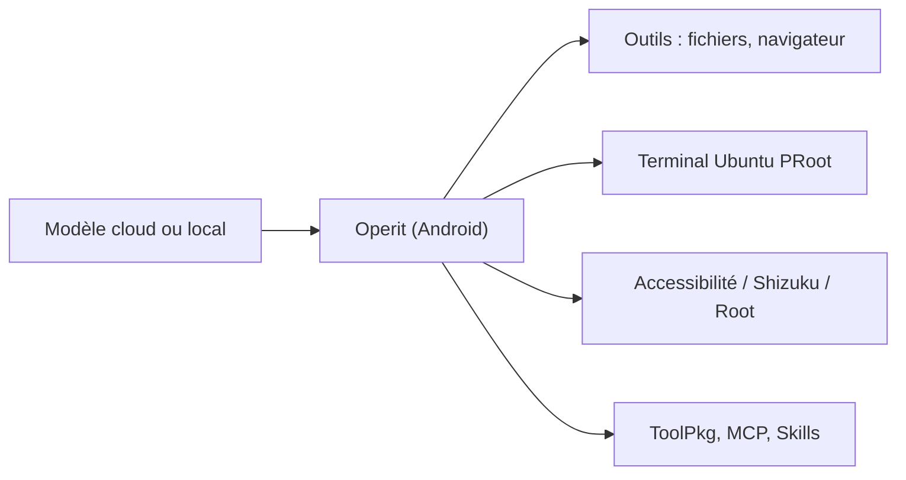

# AAswordman/Operit

> Agent IA Android qui pilote le téléphone, un terminal Ubuntu et un navigateur via outils MCP.

## Le problème
Les assistants mobiles discutent mais n'agissent pas sur le téléphone ni sur des fichiers de projet.

## Ce que ça fait vraiment
Application Android (ARM64, Android 8+) qui relie des modèles cloud (OpenAI, Anthropic, Gemini) ou locaux (MNN, GGUF via llama.cpp, Ollama) à des outils : fichiers, navigateur intégré, automatisation d'interface par Accessibilité, Shizuku ou Root, terminal Ubuntu 24.04 via PRoot. Elle ajoute mémoire à graphe, personnages, workflows et marché d'extensions (ToolPkg, MCP, Skills). Chat Web et API HTTP, désactivés par défaut.

## Comment c'est branché


## Essayer
```bash
# Aucune commande documentée : télécharger l'APK depuis la page Releases,
# l'installer, puis suivre l'assistant de configuration des modèles.
```

## Coût et pièges
Clé du fournisseur de modèle à ta charge ; mémoire et stockage dépendent des modèles locaux. Les permissions Accessibilité/Root donnent un large accès au téléphone.

## Ce que ce n'est pas
Ce dépôt est l'édition Android ; Operit 2 (Rust, Flutter, CLI) est un projet séparé. Le build exige des archives externes.

## Alternatives
Aucune alternative nommée dans le README.

## Pour toi
À surveiller : intéressant pour voir un agent mobile complet, mais LGPL, mainteneur unique et accès système étendu invitent à la prudence.

