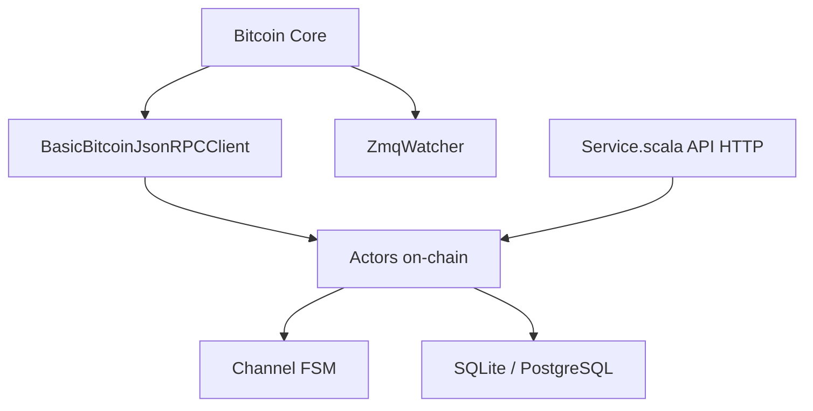

# ACINQ/eclair

> Scala implementation of a Lightning Network node, compliant with the BOLT specifications, for node operators.

## The problem
Sending and receiving Bitcoin payments off-chain requires a Lightning node that complies with the protocol.

## What it actually does
A Lightning node written in Scala on the JVM, relying on Bitcoin Core (RPC and ZMQ) for the chain and the funds. It exposes a JSON HTTP API, an `eclair-cli` CLI, JVM plugins, SQLite or PostgreSQL, a cluster front-end module and Grafana dashboards. It has no wallet of its own.

## How it is wired


## Trying it
```shell
eclair-node-<version>-<commit_id>/bin/eclair-node.sh
docker run -ti --rm -e "JAVA_OPTS=-Xmx512m -Declair.printToConsole" acinq/eclair
docker exec <container_name> eclair-cli -p foobar getinfo
```

## Cost and gotchas
Free, but requires Bitcoin Core 31 or later configured with txindex, ZMQ and segwit addresses, and Java 21. Real funds are at stake: back up the wallet, seeds and `eclair.sqlite.bak`. The API must not be exposed publicly.

## What it is not
Not a consumer wallet: a node for advanced operators. Switching wallets with open channels can lose funds.

## Alternatives
- core lightning, lnd, electrum, ldk: other Lightning implementations cited in the README.

## For you
Ignore: Bitcoin infrastructure unrelated to data, AI or MLOps work.
