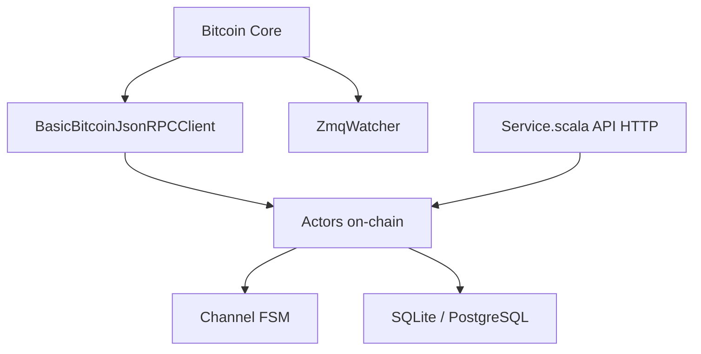

# ACINQ/eclair

> Implémentation Scala d'un nœud Lightning Network, conforme aux spécifications BOLT, pour opérateurs de nœuds.

## Le problème
Envoyer et recevoir des paiements Bitcoin hors chaîne exige un nœud Lightning conforme au protocole.

## Ce que ça fait vraiment
Un nœud Lightning en Scala sur la JVM, qui s'appuie sur Bitcoin Core (RPC et ZMQ) pour la chaîne et les fonds. Il expose une API HTTP JSON, une CLI `eclair-cli`, des plugins JVM, SQLite ou PostgreSQL, un module de front en cluster et des tableaux de bord Grafana. Il n'a pas de portefeuille propre.

## Comment c'est branché


## Essayer
```shell
eclair-node-<version>-<commit_id>/bin/eclair-node.sh
docker run -ti --rm -e "JAVA_OPTS=-Xmx512m -Declair.printToConsole" acinq/eclair
docker exec <container_name> eclair-cli -p foobar getinfo
```

## Coût et pièges
Gratuit, mais exige un Bitcoin Core 31 ou plus configuré avec txindex, ZMQ et adresses segwit, et Java 21. Des fonds réels sont en jeu : sauvegarder portefeuille, graines et `eclair.sqlite.bak`. L'API ne doit pas être exposée publiquement.

## Ce que ce n'est pas
Pas un portefeuille grand public : un nœud pour opérateurs avancés. Changer de portefeuille avec des canaux ouverts peut faire perdre des fonds.

## Alternatives
- core lightning, lnd, electrum, ldk : autres implémentations Lightning citées dans le README.

## Pour toi
Ignorer : infrastructure Bitcoin sans lien avec un travail data, IA ou MLOps.

