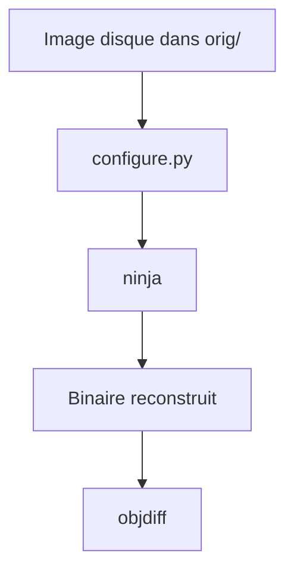

# ACreTeam/ac-decomp

> Decompilation of Animal Crossing (GameCube) into C, for game reverse-engineering enthusiasts.

## The problem
The game's official source code is not publicly available: studying or modifying it requires rebuilding it from the binary.

## What it actually does
Rebuilds source code that, once compiled, reproduces the original executable. The repository contains neither assets nor assembly: you must supply your own disc image (USA, Australia, PAL in five languages). Progress can be followed on decomp.dev.

## How it is wired


## Trying it
```sh
git clone --recursive https://github.com/Prakxo/ac-decomp.git
git submodule update --init --recursive
python configure.py
ninja
```

## Cost and gotchas
Free, but a legal copy of the game is required. Python and ninja to install; wine on macOS or off x86. Under WSL, objdiff does not receive file notifications.

## What it is not
Not a playable game nor an emulator. A version of the N64 original is handled in another repository.

## Alternatives
No alternative named, apart from the N64 decompilation in a separate repository.

## For you
Ignore: game reverse engineering, outside the data, AI or MLOps scope.
