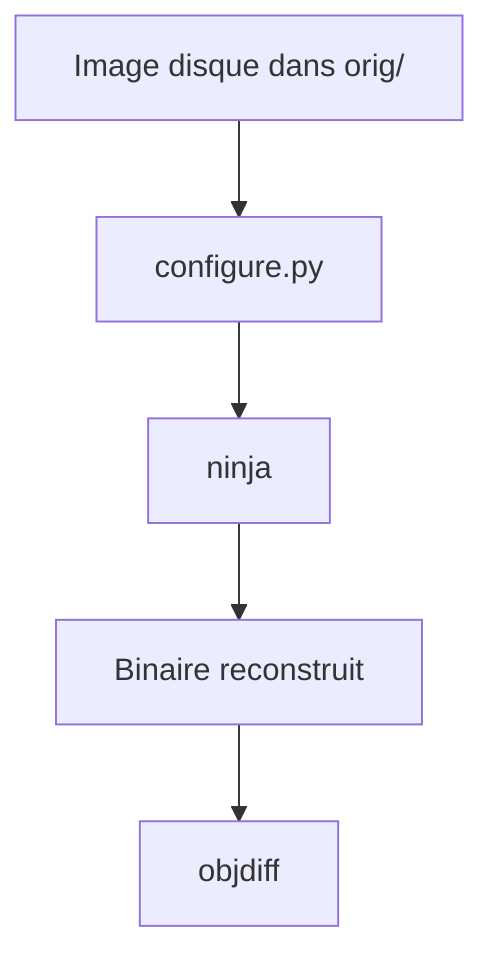

# ACreTeam/ac-decomp

> Décompilation d'Animal Crossing (GameCube) en C, pour les passionnés de rétro-ingénierie de jeux.

## Le problème
Le code source officiel du jeu n'existe pas publiquement : l'étudier ou le modifier suppose de le reconstruire depuis le binaire.

## Ce que ça fait vraiment
Reconstruit un code source qui, une fois compilé, reproduit l'exécutable d'origine. Le dépôt ne contient ni ressources ni assembleur : il faut fournir sa propre image disque (USA, Australie, PAL en cinq langues). La progression se suit sur decomp.dev.

## Comment c'est branché


## Essayer
```sh
git clone --recursive https://github.com/Prakxo/ac-decomp.git
git submodule update --init --recursive
python configure.py
ninja
```

## Coût et pièges
Gratuit, mais une copie légale du jeu est requise. Python et ninja à installer ; wine sur macOS ou hors x86. Sous WSL, objdiff ne reçoit pas les notifications de fichiers.

## Ce que ce n'est pas
Pas un jeu jouable ni un émulateur. Une version de l'original N64 est traitée dans un autre dépôt.

## Alternatives
Aucune alternative nommée, hors décompilation N64 d'un dépôt séparé.

## Pour toi
Ignorer : de la rétro-ingénierie de jeu, hors périmètre data, IA ou MLOps.

