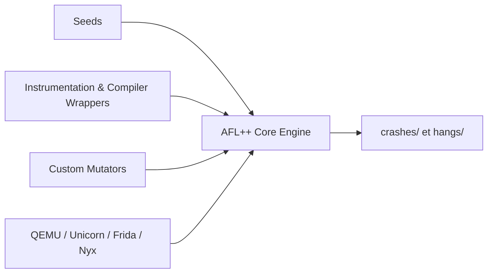

# AFLplusplus/AFLplusplus

> Instrumentation-based fuzzing framework, an improved fork of AFL, for security researchers and C/C++ developers.

## The problem
Finding crashes in code that parses inputs requires generating and mutating test cases guided by coverage.

## What it actually does
The `afl-fuzz` engine mutates inputs, compiles targets with `afl-cc` (instrumentation, CMPLOG) and detects crashes and hangs. QEMU, Unicorn, Frida and Nyx modes for binaries without source; custom mutators (C, Rust). AGPL-3.0 license; compiled harnesses remain Apache-2.0, optional commercial license.

## How it is wired


## Trying it
```bash
docker pull aflplusplus/aflplusplus
docker run -ti -v /location/of/your/target:/src aflplusplus/aflplusplus
CC=/path/to/afl-cc CXX=/path/to/afl-c++ ./configure --disable-shared
make clean all
./afl-fuzz -i seeds_dir -o output_dir -- /path/to/tested/program
```

## Cost and gotchas
Free; fuzzing takes CPU time and days. The README warns about the risks of fuzzing. Only PRs to `dev` are accepted.

## What it is not
Not a turnkey scanner: you must compile the target and provide seeds.

## Alternatives
No alternative named in the README (Google's fuzzbench is cited for comparison).

## For you
Worth watching: useful for hardening native inference or parsing libraries; marginal for a pure data profile.
