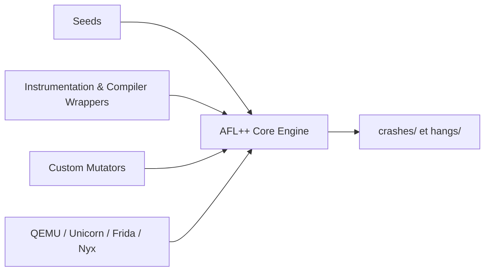

# AFLplusplus/AFLplusplus

> Framework de fuzzing par instrumentation, fork amélioré d'AFL, pour chercheurs en sécurité et développeurs C/C++.

## Le problème
Trouver des plantages dans du code parsant des entrées demande de générer et muter des cas de test guidés par la couverture.

## Ce que ça fait vraiment
Le moteur `afl-fuzz` mute des entrées, compile les cibles avec `afl-cc` (instrumentation, CMPLOG) et détecte plantages et blocages. Modes QEMU, Unicorn, Frida et Nyx pour les binaires sans source ; mutateurs personnalisés (C, Rust). Licence AGPL-3.0 ; les harnais compilés restent Apache-2.0, licence commerciale optionnelle.

## Comment c'est branché


## Essayer
```bash
docker pull aflplusplus/aflplusplus
docker run -ti -v /location/of/your/target:/src aflplusplus/aflplusplus
CC=/path/to/afl-cc CXX=/path/to/afl-c++ ./configure --disable-shared
make clean all
./afl-fuzz -i seeds_dir -o output_dir -- /path/to/tested/program
```

## Coût et pièges
Gratuit ; fuzzer demande du temps CPU et des jours. Le README avertit des risques du fuzzing. Seules les PR vers `dev` sont acceptées.

## Ce que ce n'est pas
Pas un scanner clé en main : il faut compiler la cible et fournir des graines.

## Alternatives
Aucune alternative nommée dans le README (le fuzzing de Google fuzzbench est cité pour comparer).

## Pour toi
À surveiller : utile pour durcir des bibliothèques natives d'inférence ou de parsing ; marginal pour un profil pur data.

