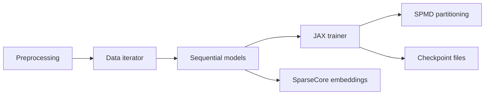

# AI-Hypercomputer/RecML

> Keras/JAX recommendation library optimized for Cloud TPU and SparseCore, for researchers and practitioners.

## The problem
Training recommenders with large embedding tables on TPU requires rewriting data handling, partitioning and metrics.

## What it actually does
Provides reference implementations (SASRec, BERT4Rec, Mamba4Rec, HSTU, DLRM v2), reusable layers, embedding APIs for SparseCore and standard metrics (AUC, NDCG@K, MRR, Recall@K). A unified trainer targets TPU or GPU with SPMD sharding, checkpoints and logging (e.g. BigQuery). The README expresses a vision more than a user guide.

## How it is wired


## Trying it
```bash
# Aucune commande documentée dans le README.
```

## Cost and gotchas
Designed for Cloud TPU (billed by Google Cloud); GPU possible. Installation not documented in the README.

## What it is not
Not a ready-to-install library according to the README: "aims to house" is an ambition. Some listed models are not confirmed in the sampled code.

## Alternatives
No alternative named in the README.

## For you
Keep an eye on it: interesting if you build recommenders on TPU, but there is nothing to install or run according to the README.
