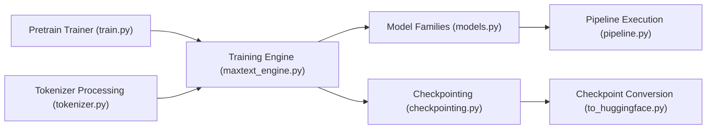

# AI-Hypercomputer/maxtext

> Google's JAX library for pre-training and post-training LLMs at scale on TPUs and GPUs.

## The problem
Training models with billions of parameters on thousands of chips requires highly optimized sharding, checkpoint and pipeline code.

## What it actually does
A Python/JAX model library (Gemma, Llama, DeepSeek, Qwen, Mistral, Kimi, GPT-OSS) with pre-training, SFT and RL (GRPO, GSPO) via Tunix, vLLM for sampling. Built on Flax, Orbax, Optax and Grain. Offline inference, checkpoint conversion to Hugging Face, evaluation. A "decoupled mode" avoids GCP dependencies.

## How it is wired

## Trying it
The README contains no command: it points to an installation guide (pip from PyPI), to the decoupled mode and to SFT/RL guides.

## Cost and gotchas
Targets Google Cloud TPUs and GPUs: very expensive hardware. Python 3.12 recommended. The `main` branch is not production-ready: prefer the PyPI releases.

## What it is not
Not a lightweight fine-tuning tool for a single card. The README also mentions a separate repository for diffusion models.

## Alternatives
- MaxDiffusion: a neighboring repository for diffusion models.

## For you
Worth watching: a serious reference if you train on TPUs; without a cluster, a tool too heavy for your use.
