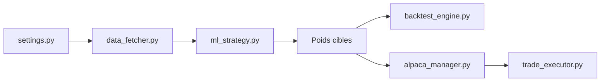

# AI4Finance-Foundation/FinRL-Trading

> Modular Python infrastructure to backtest and run portfolio-weight trading strategies.

## The problem
Strategies differ between backtest and live execution; a common contract is needed between strategy logic and broker.

## What it actually does
The target weight vector is the single interface between stock selection, allocation, timing and risk overlay. Data comes from Yahoo, FMP or WRDS (SQLite cache), backtesting uses `bt`, execution goes through Alpaca (multi-account, risk controls). Three use cases: classic and DRL allocations, quarterly stock selection by ML and DRL, adaptive asset rotation. A `deploy.sh` script chains data, strategy and paper mode.

## How it is wired


## Trying it
```bash
git clone https://github.com/AI4Finance-Foundation/FinRL-Trading.git
cd FinRL-Trading
./deploy.sh --strategy adaptive_rotation --mode backtest
./deploy.sh --strategy adaptive_rotation --mode paper --dry-run
```

## Cost and gotchas
Yahoo Finance is free; FMP and Alpaca require keys in `.env`. The price CSVs must exist under `data/fmp_daily/` before a manual run.

## What it is not
The returns in the README (backtest 2018-2025, paper trading October 2025 to March 2026) are published by the authors, unaudited. The repository declares itself educational, not financial advice.

## Alternatives
The README table compares with Qlib, TradingAgents, Zipline/Backtrader and QuantConnect Lean.

## For you
Worth watching: clear structure for testing ML/DRL strategies, but unverified performance and many external data dependencies.
