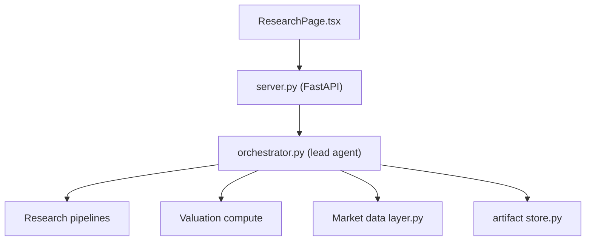

# AI4Finance-Foundation/FinRobot

> Open-source AI agent platform for equity research and financial decisions, in three generations.

## The problem
Producing a traceable financial analysis (valuation, report) without the language model inventing the figures.

## What it actually does
Three projects: V0 (AutoGen, educational, `pip install finrobot`), V1 (FastAPI web app for reports) and V2 (PydanticAI desktop workstation, presented as the production version). Figures come from deterministic Python operators (DCF, DDM, LBO, comparables), the LLM writes the text. V2 provides a CLI, a local web UI and a macOS app.

## How it is wired


## Trying it
```bash
cd finrobot_desktop
uv sync
(cd desktop && npm install)
./dev.sh
finrobot research AAPL
finrobot dcf MSFT
```

## Cost and gotchas
Keys at your expense: FMP, Finnhub, OpenAI (V1/V0), etc. The desktop build is limited to macOS Apple Silicon and not notarized. The local API is unauthenticated in browser mode. `dev.sh` frees ports 8321 and 5173.

## What it is not
Not ready-made investment advice. V3 is "under development". V0 is not intended for production. Part of the README is devoted to a commercial offering (FinRobot Pro).

## Alternatives
FinGPT, cited by the README as the single-model paradigm from which FinRobot distinguishes itself; AutoGen, the basis of V0.

## For you
Worth watching: the separation of deterministic computation from LLM narration is a good pattern for data agents, but real use depends on paid data providers.
