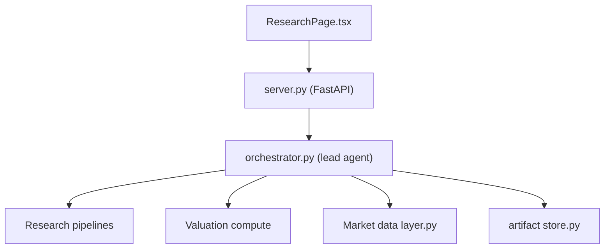

# AI4Finance-Foundation/FinRobot

> Plateforme d'agents IA open source pour la recherche en actions et les décisions financières, en trois générations.

## Le problème
Produire une analyse financière traçable (valorisation, rapport) sans que le modèle de langage invente les chiffres.

## Ce que ça fait vraiment
Trois projets : V0 (AutoGen, pédagogique, `pip install finrobot`), V1 (appli web FastAPI de rapports) et V2 (poste de travail desktop PydanticAI, présenté comme la version de production). Les chiffres viennent d'opérateurs Python déterministes (DCF, DDM, LBO, comparables), le LLM rédige. V2 fournit une CLI, une UI web locale et une appli macOS.

## Comment c'est branché


## Essayer
```bash
cd finrobot_desktop
uv sync
(cd desktop && npm install)
./dev.sh
finrobot research AAPL
finrobot dcf MSFT
```

## Coût et pièges
Clés à ta charge : FMP, Finnhub, OpenAI (V1/V0), etc. Le build desktop est limité à macOS Apple Silicon et non notarisé. L'API locale est non authentifiée en mode navigateur. `dev.sh` libère les ports 8321 et 5173.

## Ce que ce n'est pas
Pas un conseil en investissement prêt à l'emploi. V3 est « en développement ». V0 n'est pas destiné à la production. Une partie du README est consacrée à une offre commerciale (FinRobot Pro).

## Alternatives
FinGPT, cité par le README comme le paradigme mono-modèle dont FinRobot se distingue ; AutoGen, base de la V0.

## Pour toi
À surveiller : la séparation calcul déterministe / narration LLM est un bon patron pour des agents data, mais l'usage réel dépend de fournisseurs de données payants.

