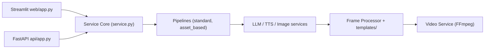

# AIDC-AI/Pixelle-Video

> An engine that turns a topic into a short narrated video, chaining LLM, images, voice and editing.

## The problem
Producing a short video requires writing, illustrating, recording a voice and editing. Each step involves a different tool.

## What it actually does
From a theme or a supplied script, it generates the text via an LLM, plans a storyboard, produces images or clips (ComfyUI or RunningHub workflows, or direct APIs DashScope, OpenAI, Seedream, Seedance, Kling), synthesizes the voice (Edge-TTS, Index-TTS), applies HTML templates per resolution and composes with FFmpeg. Streamlit interface and FastAPI API with a task manager.

## How it is wired


## Trying it
```bash
git clone https://github.com/AIDC-AI/Pixelle-Video.git
cd Pixelle-Video
uv run streamlit run web/app.py
```

## Cost and gotchas
Prerequisites: `uv` and `ffmpeg`. The README mentions a free option (Ollama + local ComfyUI); cloud model APIs are billed per use. A turnkey Windows package exists.

## What it is not
It is not a model: it orchestrates external services. Quality depends on the models plugged in. Apache-2.0 license (repository also visible under ATH-MaaS with the same content).

## Alternatives
- MoneyPrinterTurbo: video generation tool cited as an inspiration.
- NarratoAI: automated film commentary.
- MoneyPrinterPlus: video creation platform.

## For you
Watch: a good example of LLM + ComfyUI orchestration to study, but its main use is content creation, not your core business.
