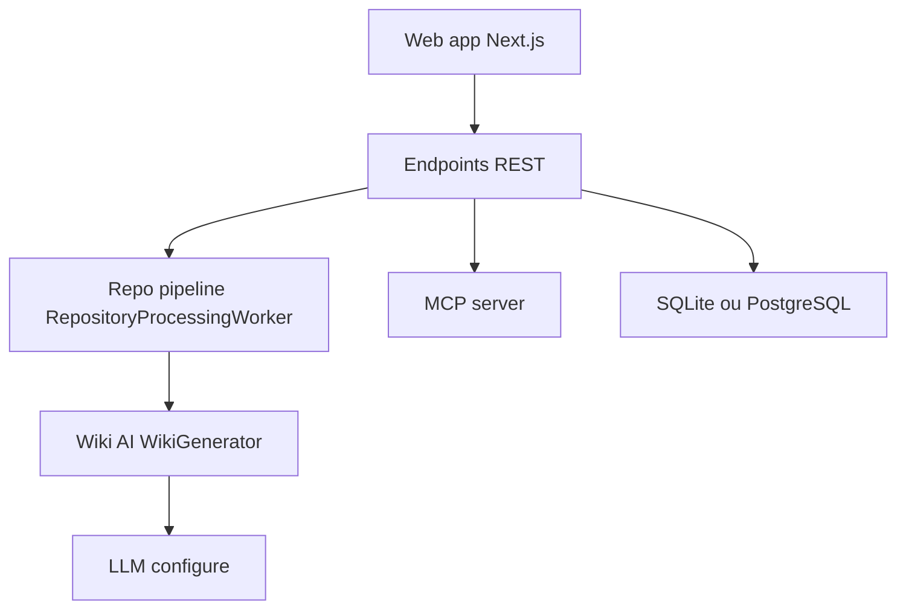

# AIDotNet/OpenDeepWiki

> Turns Git repositories, ZIP archives or folders into an AI-generated knowledge base, with chat and MCP.

## The problem
Understanding an unfamiliar repository means reading a lot of code; documentation is missing or out of date.

## What it actually does
ASP.NET Core (.NET 10) backend and Next.js interface. It imports a repository, generates a README, overview, wiki catalog, content, translations and mind maps, then publishes the site. The same content feeds the built-in chat, integration APIs and per-repository MCP endpoints. Admin console, task queues, Feishu, QQ, WeChat and Slack channels. SQLite or PostgreSQL.

## How it is wired


## Trying it
```bash
git clone https://github.com/AIDotNet/OpenDeepWiki.git
cd OpenDeepWiki
docker compose up -d --build
```
Interface: http://localhost:3000.

## Cost and gotchas
Generation is billed to you (LLM keys for catalog and content). Default admin account `admin@routin.ai` / `Admin@123` must be changed before any deployment; also change `JWT_SECRET_KEY`.

## What it is not
Not a simple code reader: it sends the repository content to your model providers. Paid support exists (pricing page).

## Alternatives
No alternative named in the README.

## For you
Worth watching if you want to automatically document large internal repositories; watch the token cost and change the default credentials.
