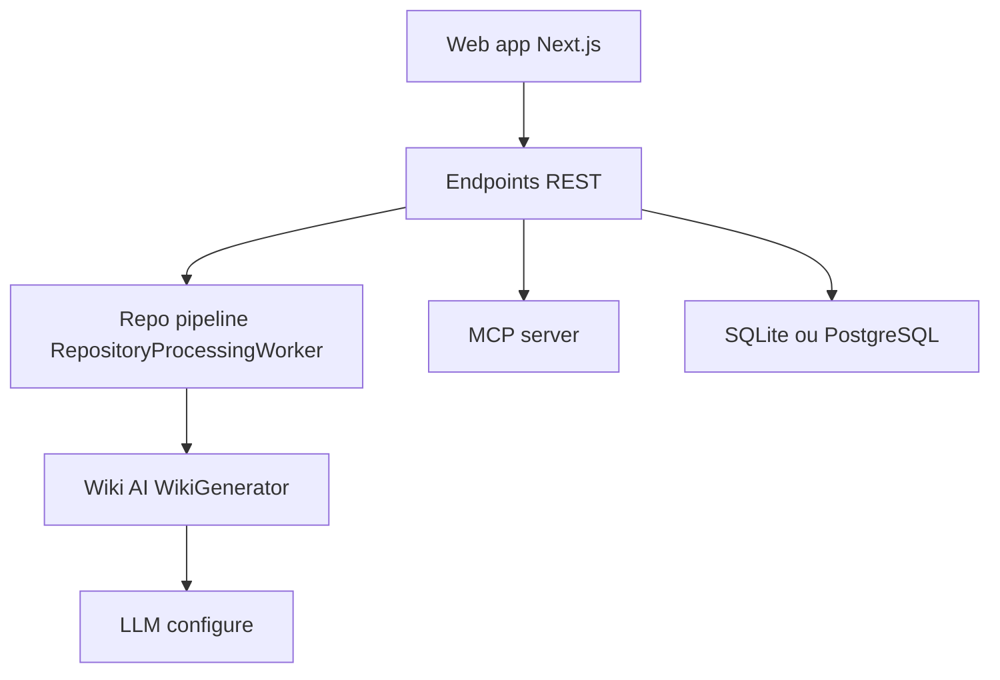

# AIDotNet/OpenDeepWiki

> Transforme dépôts Git, archives ZIP ou dossiers en base de connaissances générée par IA, avec chat et MCP.

## Le problème
Comprendre un dépôt inconnu demande de lire beaucoup de code ; la documentation manque ou n'est pas à jour.

## Ce que ça fait vraiment
Backend ASP.NET Core (.NET 10) et interface Next.js. Il importe un dépôt, génère README, vue d'ensemble, catalogue wiki, contenu, traductions et cartes mentales, puis publie le site. Les mêmes contenus servent le chat intégré, des API d'intégration et des points MCP par dépôt. Console d'administration, files de tâches, canaux Feishu, QQ, WeChat, Slack. SQLite ou PostgreSQL.

## Comment c'est branché


## Essayer
```bash
git clone https://github.com/AIDotNet/OpenDeepWiki.git
cd OpenDeepWiki
docker compose up -d --build
```
Interface : http://localhost:3000.

## Coût et pièges
Génération facturée à ta charge (clés LLM pour catalogue et contenu). Compte admin par défaut `admin@routin.ai` / `Admin@123` à changer avant tout déploiement ; changer aussi `JWT_SECRET_KEY`.

## Ce que ce n'est pas
Pas un simple lecteur de code : il envoie le contenu du dépôt à tes fournisseurs de modèles. Un support payant existe (page de tarifs).

## Alternatives
Aucune alternative nommée dans le README.

## Pour toi
À surveiller si tu veux documenter automatiquement de grands dépôts internes ; surveille le coût en jetons et change les identifiants par défaut.

