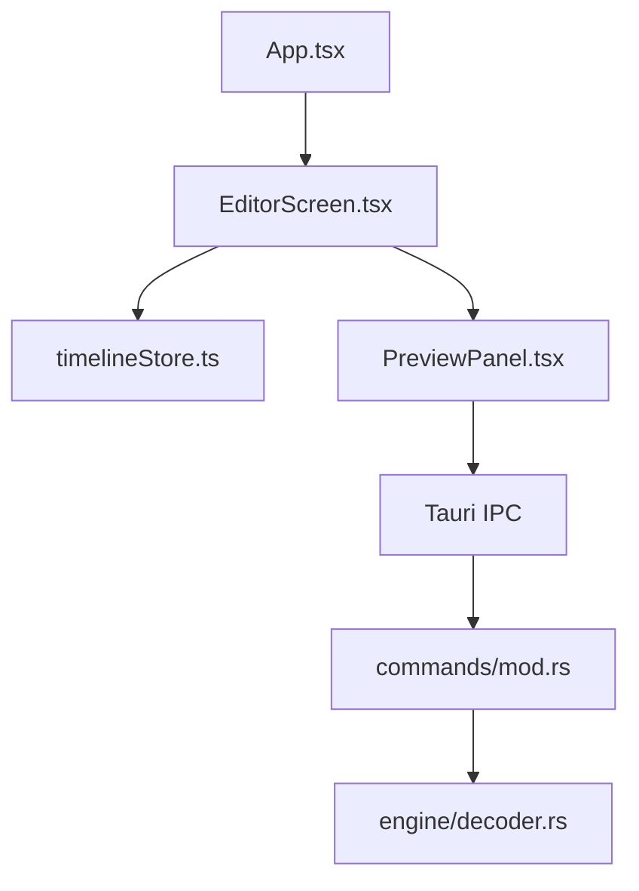

# AIEraDev/Clypra

> Free, open video editor built with Rust, Tauri and React, with hardware decoding and a multitrack timeline.

## The problem
Serious video editors are often paid, with watermarks or subscriptions.

## What it actually does
Desktop application: multitrack timeline, frame-accurate cutting, audio with waveforms, text and filters, import and export of common formats (MP4, MOV, ProRes, H.264). Decoding goes through FFmpeg and hardware acceleration on the Rust side; rendering through a GPU compositor. AI tools and thumbnails are mentioned.

## How it is wired


## Trying it
```bash
git clone https://github.com/AIEraDev/clypra.git
cd clypra
npm install
cp .env.example .env
npm run tauri dev
```

## Cost and gotchas
Free, binaries for macOS, Windows and Linux. Building requires Node 18+, Rust 1.70+, FFmpeg 6+ with headers. Performance telemetry included (timing figures, system and GPU model, no personal data according to the README).

## What it is not
Not a generative AI tool: the core is editing. Repository created in April 2026: little track record on reliability.

## Alternatives
No alternative cited in the README.

## For you
Ignore: video editing is not your field, and the telemetry is one more reason not to install it without a need.
