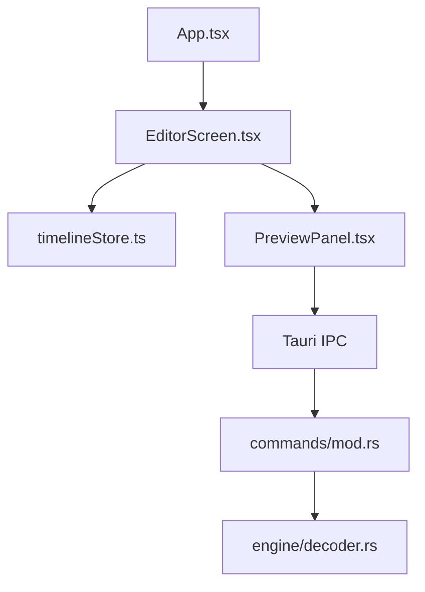

# AIEraDev/Clypra

> Éditeur vidéo gratuit et ouvert en Rust, Tauri et React, avec décodage matériel et timeline multipiste.

## Le problème
Les éditeurs vidéo sérieux sont souvent payants, avec filigrane ou abonnement.

## Ce que ça fait vraiment
Application de bureau : timeline multipiste, découpe à l'image, audio avec formes d'onde, texte et filtres, import et export de formats courants (MP4, MOV, ProRes, H.264). Le décodage passe par FFmpeg et l'accélération matérielle côté Rust ; le rendu par un compositeur GPU. Des outils d'IA et des miniatures sont mentionnés.

## Comment c'est branché


## Essayer
```bash
git clone https://github.com/AIEraDev/clypra.git
cd clypra
npm install
cp .env.example .env
npm run tauri dev
```

## Coût et pièges
Gratuit, binaires pour macOS, Windows et Linux. Compilation : Node 18+, Rust 1.70+, FFmpeg 6+ avec en-têtes. Télémétrie de performance incluse (chiffres de temps, système et modèle de GPU, sans données personnelles selon le README).

## Ce que ce n'est pas
Pas un outil d'IA générative : le cœur est l'édition. Dépôt créé en avril 2026 : peu de recul sur la fiabilité.

## Alternatives
Aucune alternative citée dans le README.

## Pour toi
Ignorer : l'édition vidéo n'est pas ton domaine, et la télémétrie est une raison de plus de ne pas l'installer sans besoin.

