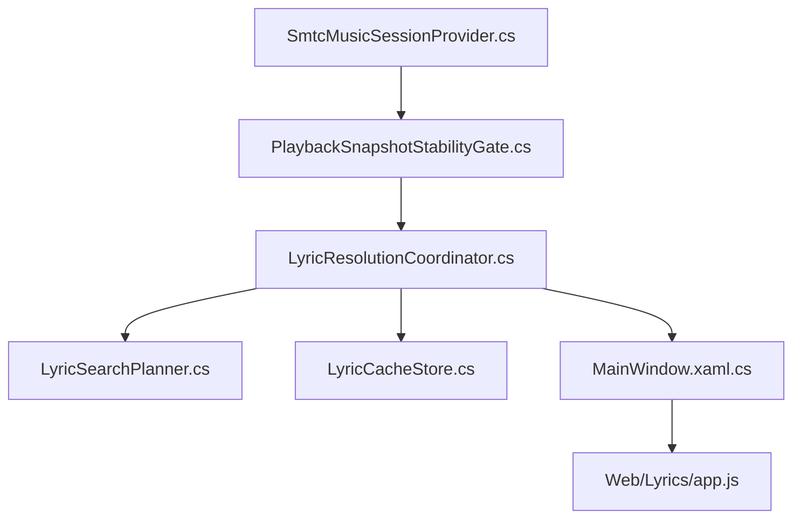

# ANYNC/TaskbarLyrics

> Displays a song's synchronized lyrics in the Windows taskbar.

## The problem
Following a track's lyrics forces you to keep the player window open.

## What it actually does
Reads the Windows media session, looks up lyrics from online services (including QQ Music) or locally (.lrc, .qrc, .krc), and displays them in a WebView placed in the taskbar. Handles translation, audio spectrum, per-track offset and multiple screens. README in Chinese.

## How it is wired


## Trying it
```bash
dotnet restore
dotnet run --project TaskbarLyrics.App
dotnet build TaskbarLyrics.sln
```

## Cost and gotchas
Windows 10 / 11 x64 and WebView2. To build: .NET 8 SDK and Windows 11 SDK. Online search sends title, artist, album and duration to the lyrics services.

## What it is not
Not a music player nor a cross-platform tool. Some players (Netease, Kugou) give incomplete synchronization.

## Alternatives
- BetterLyrics: source of inspiration for lyrics search, cited in the README.

## For you
Consumer Windows gadget unrelated to data / AI: ignore.
