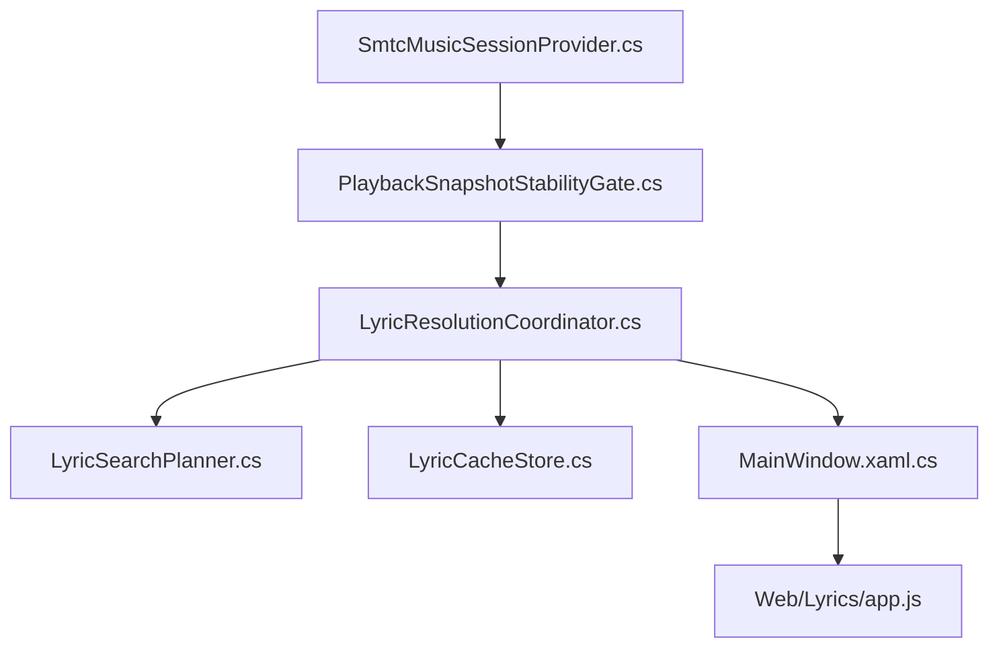

# ANYNC/TaskbarLyrics

> Affiche les paroles synchronisées d'une chanson dans la barre des tâches Windows.

## Le problème
Suivre les paroles d'un morceau oblige à garder la fenêtre du lecteur ouverte.

## Ce que ça fait vraiment
Lit la session média Windows, cherche les paroles auprès de services en ligne (dont QQ Musique) ou localement (.lrc, .qrc, .krc), et les affiche dans une WebView placée dans la barre des tâches. Gère traduction, spectre audio, décalage par morceau et plusieurs écrans. README en chinois.

## Comment c'est branché


## Essayer
```bash
dotnet restore
dotnet run --project TaskbarLyrics.App
dotnet build TaskbarLyrics.sln
```

## Coût et pièges
Windows 10 / 11 x64 et WebView2. Pour compiler : .NET 8 SDK et Windows 11 SDK. La recherche en ligne envoie titre, artiste, album et durée aux services de paroles.

## Ce que ce n'est pas
Pas un lecteur de musique ni un outil multiplateforme. Certains lecteurs (Netease, Kugou) donnent une synchro incomplète.

## Alternatives
- BetterLyrics : source d'inspiration pour la recherche de paroles, citée au README.

## Pour toi
Gadget grand public Windows sans rapport avec la data / IA : à ignorer.

