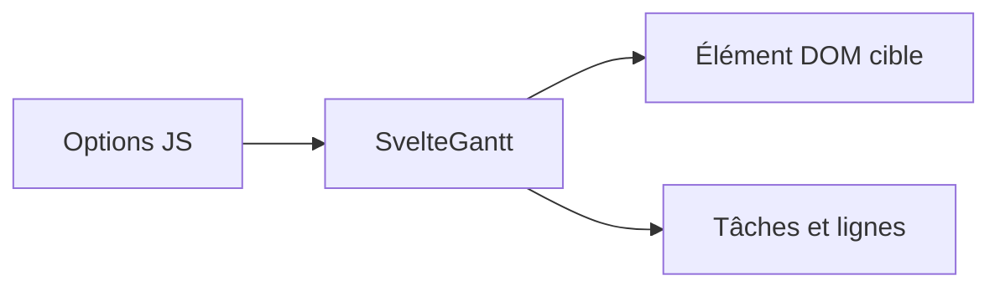

# ANovokmet/svelte-gantt

> Interactive Gantt chart component in Svelte, dependency-free, usable with any framework.

## The problem
Displaying and manipulating a schedule or resource booking in a web page requires a dedicated component.

## What it actually does
Drag-and-drop Gantt with tree view, zoom, dependencies and date ranges, advertised for large datasets. Importable as a module or as an IIFE.

## How it is wired
Simplified diagram based on the sheet, no diagram provided.


## Trying it
```bash
npm install svelte-gantt
```
```js
import { SvelteGantt } from 'svelte-gantt';
```

## Cost and gotchas
Free. Last push in May 2025, 39 open issues, a single maintainer. The options have to be discovered, the README does not detail them.

## What it is not
It is not a project management suite: it is a display component. Undocumented: options and events.

## Alternatives
No alternative named in the README.

## For you
Ignore: a UI component unrelated to data or AI, and not very active.
