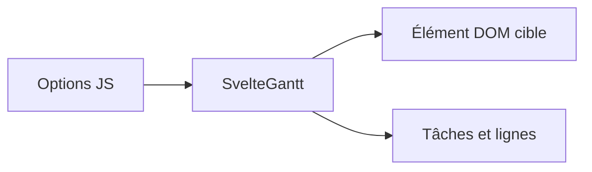

# ANovokmet/svelte-gantt

> Composant de diagramme de Gantt interactif en Svelte, sans dépendance, utilisable avec tout framework.

## Le problème
Afficher et manipuler un planning ou une réservation de ressources dans une page web demande un composant dédié.

## Ce que ça fait vraiment
Gantt en glisser-déposer avec vue en arbre, zoom, dépendances et plages de dates, annoncé pour de gros jeux de données. S'importe en module ou en IIFE.

## Comment c'est branché
Schéma simplifié d'après la fiche, sans diagramme fourni.


## Essayer
```bash
npm install svelte-gantt
```
```js
import { SvelteGantt } from 'svelte-gantt';
```

## Coût et pièges
Gratuit. Dernier push en mai 2025, 39 issues ouvertes, un seul mainteneur. Les options sont à découvrir, le README ne les détaille pas.

## Ce que ce n'est pas
Ce n'est pas une suite de gestion de projet : c'est un composant d'affichage. Non documenté : options et évènements.

## Alternatives
Aucune alternative nommée dans le README.

## Pour toi
À ignorer : composant d'interface sans lien avec la data ou l'IA, et peu actif.

