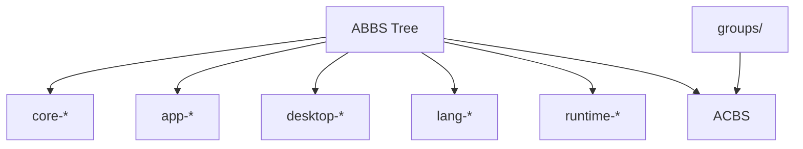

# AOSC-Dev/aosc-os-abbs

> Tree of build recipes for every package of the AOSC OS distribution.

## The problem
A Linux distribution must keep the build scripts of thousands of packages in a single place.

## What it actually does
Contains the build configurations and scripts organized by category: core, app, desktop, lang, meta, runtime. Several branches are maintained. ACBS builds series of packages using the "groups" in the groups/ folder.

## How it is wired
Simplified diagram based on the sheet, no diagram provided.

## Trying it
No command documented in the README.

## Cost and gotchas
The repository cannot be extracted on Windows (file names with backslashes): use WSL. Many open issues (294).

## What it is not
Not a tool to install: a base of package recipes for maintainers of the AOSC OS distribution.

## Alternatives
No alternative named.

## For you
Ignore: Linux distribution packaging, outside the data/AI/MLOps profile.
