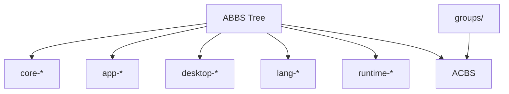

# AOSC-Dev/aosc-os-abbs

> Arbre des recettes de construction de tous les paquets de la distribution AOSC OS.

## Le problème
Une distribution Linux doit garder en un lieu unique les scripts de compilation de milliers de paquets.

## Ce que ça fait vraiment
Contient les configurations et scripts de construction organisés par catégories : core, app, desktop, lang, meta, runtime. Plusieurs branches sont tenues. ACBS construit des séries de paquets avec les « groups » du dossier groups/.

## Comment c'est branché
Schéma simplifié d'après la fiche, sans diagramme fourni.

## Essayer
Aucune commande documentée dans le README.

## Coût et pièges
Le dépôt ne s'extrait pas sous Windows (noms de fichiers avec antislash) : utiliser WSL. Beaucoup d'issues ouvertes (294).

## Ce que ce n'est pas
Pas un outil à installer : une base de recettes de paquets pour mainteneurs de la distribution AOSC OS.

## Alternatives
Aucune alternative nommée.

## Pour toi
À ignorer : packaging de distribution Linux, hors profil data/IA/MLOps.

