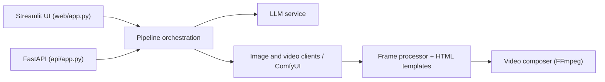

# ATH-MaaS/Pixelle-Video

> Engine that turns a topic into a short narrated video; same README as AIDC-AI/Pixelle-Video.

## The problem
Producing a short video requires writing, illustrating, recording and editing, with separate tools.

## What it actually does
The README and architecture are identical to those of AIDC-AI/Pixelle-Video: topic or script, LLM for text and prompts, media generation via ComfyUI/RunningHub or direct APIs (DashScope, OpenAI, Seedream, Seedance, Kling), TTS voice, HTML templates, FFmpeg composition. Streamlit interface (`web/app.py`), FastAPI API (`api/app.py`), typed config and a task manager. The catalog shows 28,213 stars and 168 issues, very close to the other repo.

## How it is wired


## Trying it
```bash
git clone https://github.com/AIDC-AI/Pixelle-Video.git
cd Pixelle-Video
uv run streamlit run web/app.py
```
(the README points to the AIDC-AI repo, not ATH-MaaS)

## Cost and gotchas
Same as the original: `uv`, `ffmpeg`, provider API keys, free local option (Ollama + ComfyUI). Anomaly: two repos with identical content; the relationship (mirror, rename or copy) is not documented.

## What it is not
Not a generation model; it drives external services. Nothing indicates this repo is the primary source.

## Alternatives
- AIDC-AI/Pixelle-Video: the repo the README itself points to for cloning.
- MoneyPrinterTurbo: cited inspiring tool.

## For you
Watch it, preferring the AIDC-AI repo cited in the README: a good orchestration example, outside your core field.
