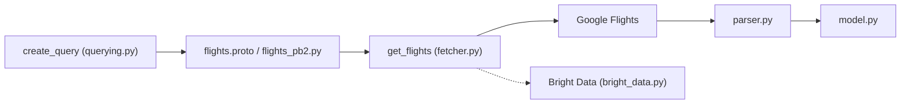

# AWeirdDev/flights

> A typed Python scraper for Google Flights, for developers who want flight prices without an official API.

## The problem
Google shut down its public flights API in 2018; the free alternatives are limited in quotas and prices.

## What it actually does
Builds a typed query (`FlightQuery`, `create_query`), encodes it as Protobuf/Base64 in the `tfs` parameter of the Google Flights URL, fetches the page and parses the embedded JavaScript data into itineraries. Filters: stopovers, airlines, times, duration, baggage, max price. Rich result: flights, cheaper alternatives, price insights, booking options.

## How it is wired


## Trying it
```bash
pip install fast-flights
```
```python
from fast_flights import FlightQuery, Passengers, create_query, get_flights
query = create_query(
    flights=[FlightQuery(date="YYYY-MM-DD", from_airport="MYJ", to_airport="TPE")],
    seat="economy", trip="one-way", passengers=Passengers(adults=1), language="zh-TW",
)
res = get_flights(query)
```

## Cost and gotchas
Free; the Bright Data integration (IP protection) is optional and assumes a third-party account. The README documents no quota or blocking risk.

## What it is not
Not an official API: it relies on the internal format of Google URLs, which can change (v3 already changed method). No booking tool.

## Alternatives
- hugoglvs/google-flights-scraper: Playwright-based, described by its author as very slow.
- SerpApi: also scrapes Google, as a managed service.

## For you
Worth watching: useful for a flight-price data prototype, but fragile because it depends on a non-contractual Google format and a single maintainer.
