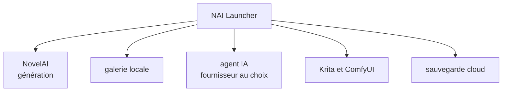

# Aaalice233/Aaalice_NAI_Launcher

> Third-party client for NovelAI: image generation, local gallery, queues and agent, on Windows, macOS and Android.

## The problem
NovelAI image creators juggle between the website, folders, prompts and other tools with no unified workflow.

## What it actually does
Text to image, image to image, inpainting, variations, Vibe Transfer and Precise Reference. Local gallery, queues with Anlas tracking, online galleries, AI agent, optional local MCP server, Krita and ComfyUI links, plaintext cloud backup (OneDrive, GitHub, WebDAV).

## How it is wired
Simplified diagram based on the fiche, no diagram provided.

## Trying it
No command: download `NAI_Launcher_Windows_..._Setup.exe`, the portable version or the APK from GitHub Releases, then log in to NovelAI.

## Cost and gotchas
A NovelAI account is mandatory, generations are paid in Anlas. The agent and translation services are billed by the chosen provider. No Linux package.

## What it is not
Not an official NovelAI product. Without a NovelAI account, only the local tools work.

## Alternatives
Not documented in the README (ComfyUI is mentioned as a connected tool).

## For you
Ignore: a creative client tied to a paid service, far from data, AI or MLOps work.
