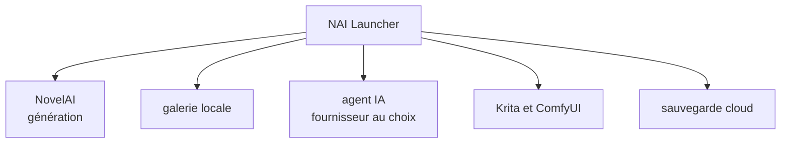

# Aaalice233/Aaalice_NAI_Launcher

> Client tiers pour NovelAI : génération d'images, galerie locale, files d'attente et agent, sur Windows, macOS et Android.

## Le problème
Les créateurs d'images NovelAI jonglent entre le site, les dossiers, les prompts et d'autres outils sans flux unifié.

## Ce que ça fait vraiment
Texte vers image, image vers image, inpainting, variantes, Vibe Transfer et Precise Reference. Galerie locale, files d'attente avec suivi des Anlas, galeries en ligne, agent IA, serveur MCP local optionnel, liens Krita et ComfyUI, sauvegarde cloud en clair (OneDrive, GitHub, WebDAV).

## Comment c'est branché
Schéma simplifié d'après la fiche, sans diagramme fourni.

## Essayer
Pas de commande : télécharger depuis GitHub Releases `NAI_Launcher_Windows_..._Setup.exe`, la version portable ou l'APK, puis se connecter à NovelAI.

## Coût et pièges
Compte NovelAI obligatoire, générations payées en Anlas. Les services de l'agent et de traduction sont facturés par le fournisseur choisi. Aucun paquet Linux.

## Ce que ce n'est pas
Pas un produit officiel NovelAI. Sans compte NovelAI, seuls les outils locaux fonctionnent.

## Alternatives
Non documenté dans le README (ComfyUI est cité comme outil connecté).

## Pour toi
À ignorer : client créatif lié à un service payant, loin d'un travail data, IA ou MLOps.

