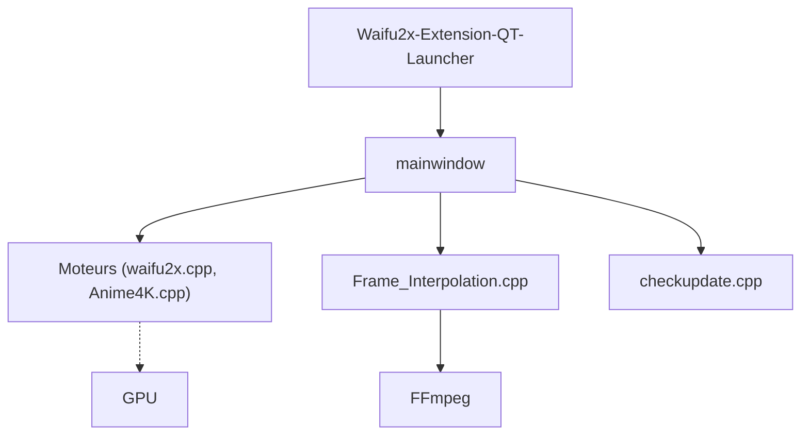

# AaronFeng753/Waifu2x-Extension-GUI

> Windows application that upscales images, GIFs and videos and interpolates video frames with neural networks, on GPU.

## The problem
Using several super-resolution and interpolation engines from the command line is tedious.

## What it actually does
Qt graphical interface that orchestrates super-resolution engines (Waifu2x, SRMD, RealSR, Real-ESRGAN, Real-CUGAN, Anime4K) and interpolation engines (RIFE, CAIN, DAIN, IFRNet). Handles multi-threading and multi-GPU on AMD, Nvidia and Intel. Uses FFmpeg for video. Portable package for Windows x64.

## How it is wired
Diagram based on the code diagram, simplified.



## Trying it
```bash
# Télécharger le paquet portable (Windows x64) :
# https://github.com/AaronFeng753/Waifu2x-Extension-GUI/releases/latest
```
Unzip then launch.

## Cost and gotchas
Free for personal use only; commercial use is reserved to the Premium version (Patreon). A GPU is required. The license is not recognized by GitHub. Connects to the Internet for updates (GitHub, Gitee).

## What it is not
Not a model nor a library: a graphical wrapper. Not cross-platform according to the README (Windows x64).

## Alternatives
- Real-ESRGAN, Waifu2x, RIFE: built-in engines, usable directly.

## For you
Keep an eye on it: handy for testing super-resolution models on GPU, but the personal-use clauses block any professional use.
