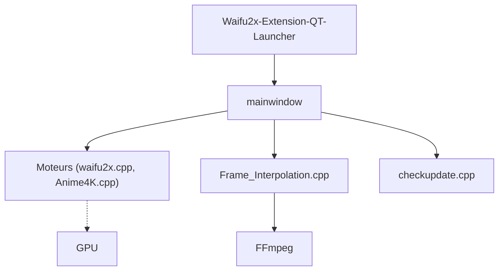

# AaronFeng753/Waifu2x-Extension-GUI

> Application Windows qui agrandit images, GIF et vidéos et interpole des images vidéo par réseaux de neurones, sur GPU.

## Le problème
Utiliser plusieurs moteurs de super-résolution et d'interpolation en ligne de commande est fastidieux.

## Ce que ça fait vraiment
Interface graphique Qt qui orchestre des moteurs de super-résolution (Waifu2x, SRMD, RealSR, Real-ESRGAN, Real-CUGAN, Anime4K) et d'interpolation (RIFE, CAIN, DAIN, IFRNet). Gère multi-thread et multi-GPU AMD, Nvidia, Intel. Utilise FFmpeg pour la vidéo. Paquet portable pour Windows x64.

## Comment c'est branché
Schéma d'après le diagramme du code, simplifié.



## Essayer
```bash
# Télécharger le paquet portable (Windows x64) :
# https://github.com/AaronFeng753/Waifu2x-Extension-GUI/releases/latest
```
Décompresser puis lancer.

## Coût et pièges
Gratuit pour usage personnel seulement ; usage commercial réservé à la version Premium (Patreon). Un GPU est nécessaire. La licence n'est pas reconnue par GitHub. Se connecte à Internet pour les mises à jour (GitHub, Gitee).

## Ce que ce n'est pas
Pas un modèle ni une bibliothèque : un habillage graphique. Pas multiplateforme d'après le README (Windows x64).

## Alternatives
- Real-ESRGAN, Waifu2x, RIFE : moteurs intégrés, utilisables directement.

## Pour toi
À surveiller : pratique pour tester des modèles de super-résolution sur GPU, mais les clauses d'usage personnel bloquent tout emploi professionnel.

