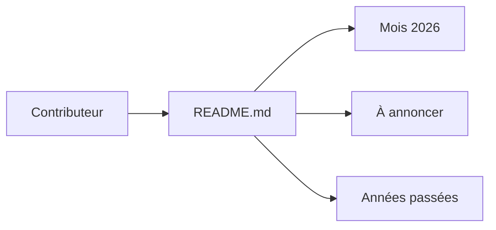

# Abacatinhos/agenda-tech-brasil

> Collaborative calendar of tech events in Brazil, in Portuguese, for local developers.

## The problem
Brazilian tech events are scattered across many websites.

## What it actually does
The README lists 2026 events by month (date, name, city, in-person, online or hybrid), a "to be announced" section and the 2022 to 2024 editions. A web version and a weekly newsletter are mentioned. Created by @pachicodes, maintained with @stephan-lopes.

## How it is wired
No architecture diagram provided: it is a README file, with no components.

## Trying it
No command documented: open the README or the website.

## Cost and gotchas
Free. No license declared: reuse needs clarifying. Content in Portuguese.

## What it is not
Not a list of data/AI events: all Brazilian tech topics appear in it.

## Alternatives
No alternative named in the README.

## For you
Ignore: geography and language are outside your scope, unless you are traveling to Brazil.
