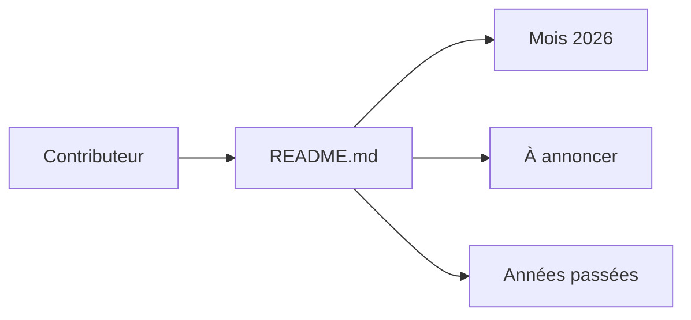

# Abacatinhos/agenda-tech-brasil

> Calendrier collaboratif des événements tech au Brésil, en portugais, pour développeurs locaux.

## Le problème
Les événements tech brésiliens sont dispersés sur de nombreux sites.

## Ce que ça fait vraiment
Le README liste par mois les événements 2026 (date, nom, ville, présentiel, en ligne ou hybride), une section « à annoncer » et les éditions 2022 à 2024. Une version web et une newsletter hebdomadaire sont citées. Créé par @pachicodes, maintenu avec @stephan-lopes.

## Comment c'est branché
Aucun diagramme d'architecture fourni : c'est un fichier README, sans composants.

## Essayer
Aucune commande documentée : ouvrir le README ou le site web.

## Coût et pièges
Gratuit. Aucune licence déclarée : réutilisation à éclaircir. Contenu en portugais.

## Ce que ce n'est pas
Pas une liste d'événements data/IA : tous les sujets tech brésiliens y figurent.

## Alternatives
Aucune alternative nommée dans le README.

## Pour toi
À ignorer : géographie et langue hors de ton périmètre, sauf déplacement au Brésil.

