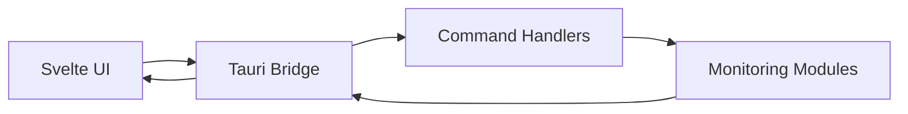

# Abdenasser/neohtop

> Desktop process monitor (CPU, memory, search, kill), built with SvelteKit and Rust/Tauri.

## The problem
`htop` in a terminal is austere; you want a graphical interface to sort, filter and kill processes.

## What it actually does
Real-time CPU and memory tracking, search by name, command or PID (commas and regular expressions), process pinning, column sorting, light/dark themes. A `neohtop-cli` CLI exists via npm. Some processes require launching with sudo.

## How it is wired


## Trying it
```bash
brew install --cask neohtop
npm install -g neohtop-cli
```

## Cost and gotchas
Free, MIT. Packages from package managers (Homebrew, AUR, Scoop...) are community-maintained and not guaranteed by the author. Last push in March 2026.

## What it is not
Not a fleet or GPU monitoring tool: it monitors a single machine.

## Alternatives
No alternative named in the README.

## For you
Ignore: a personal convenience, unrelated to job or GPU tracking.
