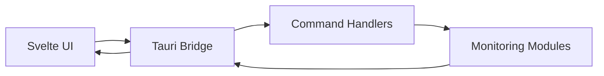

# Abdenasser/neohtop

> Moniteur de processus de bureau (CPU, mémoire, recherche, kill), en SvelteKit et Rust/Tauri.

## Le problème
`htop` en terminal est austère ; on veut une interface graphique pour trier, filtrer et tuer des processus.

## Ce que ça fait vraiment
Suivi en temps réel de CPU et mémoire, recherche par nom, commande ou PID (virgules et expressions régulières), épinglage de processus, tri par colonne, thèmes clair/sombre. Une CLI `neohtop-cli` existe via npm. Certains processus exigent un lancement avec sudo.

## Comment c'est branché


## Essayer
```bash
brew install --cask neohtop
npm install -g neohtop-cli
```

## Coût et pièges
Gratuit, MIT. Les paquets des gestionnaires (Homebrew, AUR, Scoop…) sont communautaires et non garantis par l'auteur. Dernier push en mars 2026.

## Ce que ce n'est pas
Pas un outil de supervision de flotte ni de GPU : il surveille une machine.

## Alternatives
Aucune alternative nommée dans le README.

## Pour toi
Ignorer : un confort personnel, sans lien avec le suivi de jobs ou de GPU.

