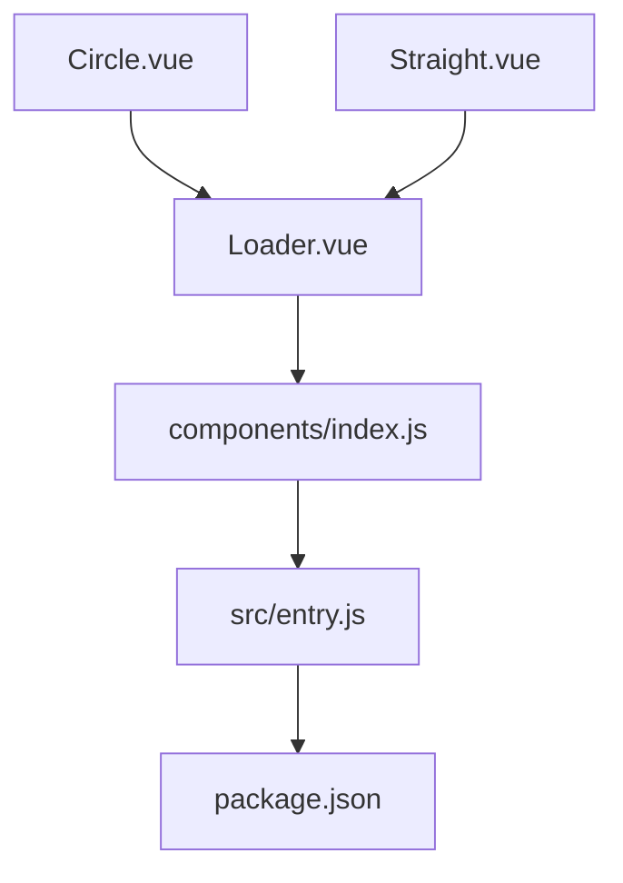

# Abdulqudus001/vue-skeleton-loader

> Vue component that displays a loading skeleton while data is being fetched.

## The problem
An empty screen during loading degrades the experience.

## What it actually does
`vue-skeleton-loader` component: rectangle or circle shape, width, height, color, animation (fade, wave, pulse, pulse-x, pulse-y) and border radius. `Loader.vue` chooses the shape, `index.js` exports it, `entry.js` is the package entry point.

## How it is wired


## Trying it
```bash
npm install skeleton-loader-vue --save
npm run serve
npm run build
```

## Cost and gotchas
Free. Uses the `Vue.component` syntax, so it is designed for Vue 2.

## What it is not
Not a full component library: a single loading component.

## Alternatives
No alternative named in the README.

## For you
Ignore: web UI component, outside your data / AI work.
