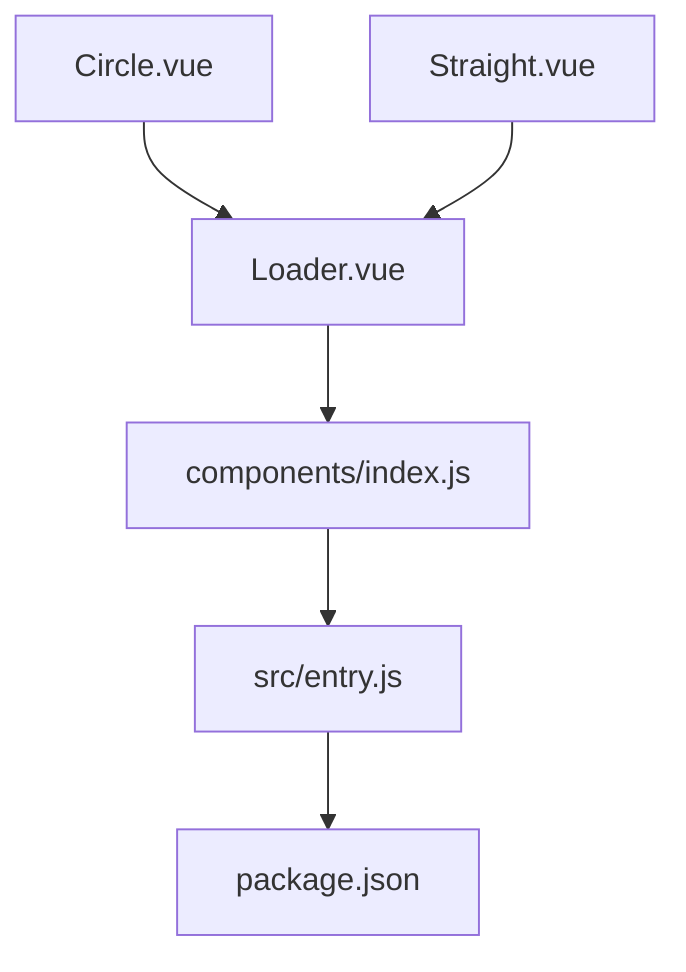

# Abdulqudus001/vue-skeleton-loader

> Composant Vue qui affiche un squelette de chargement pendant la récupération des données.

## Le problème
Un écran vide pendant le chargement dégrade l'expérience.

## Ce que ça fait vraiment
Composant `vue-skeleton-loader` : forme rectangle ou cercle, largeur, hauteur, couleur, animation (fade, wave, pulse, pulse-x, pulse-y) et rayon de bordure. `Loader.vue` choisit la forme, `index.js` l'exporte, `entry.js` est le point d'entrée du paquet.

## Comment c'est branché


## Essayer
```bash
npm install skeleton-loader-vue --save
npm run serve
npm run build
```

## Coût et pièges
Gratuit. Syntaxe de `Vue.component`, donc pensé pour Vue 2.

## Ce que ce n'est pas
Pas une bibliothèque de composants complète : un seul composant d'attente.

## Alternatives
Aucune alternative nommée dans le README.

## Pour toi
Ignorer : composant d'interface web, hors de ton travail data / IA.

