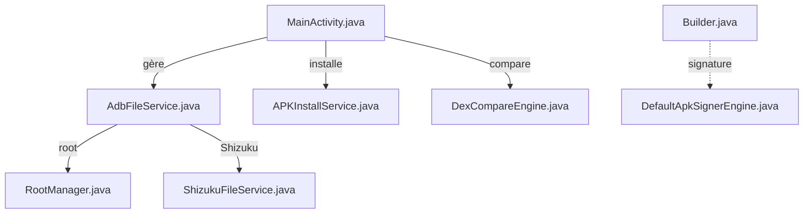

# AbdurazaaqMohammed/MP-Manager

> Dual-pane Android file manager focused on APK editing, a free alternative to MT Manager.

## The problem
Editing, signing and inspecting APKs on the phone means using a closed tool (MT Manager) or several separate apps.

## What it actually does
Two-pane navigation, file and archive operations, root or Shizuku access, text, hex, dex and resources.arsc editors, APK signing and merging. A built-in MCP server (port 8787) lets an AI drive files, ZIPs and APKs.

## How it is wired


## Trying it
```bash
# Aucune commande documentée dans l'extrait lu : l'appli s'installe comme un APK Android.
# Le service MCP se lance depuis la barre latérale ("MCP Service") et sert http://<ip>:8787/mcp
```

## Cost and gotchas
Free, but no installation or version is detailed in the README read. The MCP service is not encrypted: the README advises against exposing the port to the Internet. Several tools serve to bypass protections (SSL unpinning, signing): use only on your own apps. The code is largely written with AI.

## What it is not
Not an MLOps or data tool. Not a proven app: the repository dates from June 2026 and relies on a single developer.

## Alternatives
MT Manager (closed), cited as the reference; REAndroid APKEditor, whose features are reused.

## For you
Watch: only the "MCP server that drives an app" angle interests an AI profile; the rest is Android tooling outside your scope.
