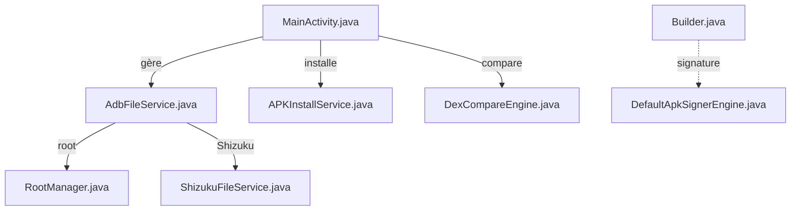

# AbdurazaaqMohammed/MP-Manager

> Gestionnaire de fichiers Android à double panneau, centré sur l'édition d'APK, alternative libre à MT Manager.

## Le problème
Éditer, signer et inspecter des APK sur le téléphone passe par un outil fermé (MT Manager) ou plusieurs applis séparées.

## Ce que ça fait vraiment
Navigation à deux panneaux, opérations sur fichiers et archives, accès root ou Shizuku, éditeurs texte, hexadécimal, dex et resources.arsc, signature et fusion d'APK. Un serveur MCP intégré (port 8787) laisse une IA piloter fichiers, ZIP et APK.

## Comment c'est branché


## Essayer
```bash
# Aucune commande documentée dans l'extrait lu : l'appli s'installe comme un APK Android.
# Le service MCP se lance depuis la barre latérale ("MCP Service") et sert http://<ip>:8787/mcp
```

## Coût et pièges
Gratuit, mais aucune installation ni version n'est détaillée dans le README lu. Le service MCP n'est pas chiffré : le README déconseille d'exposer le port à Internet. Plusieurs outils servent à contourner des protections (SSL unpinning, signature) : à n'utiliser que sur ses propres applis. Le code est en grande partie écrit avec de l'IA.

## Ce que ce n'est pas
Pas un outil de MLOps ni de data. Pas une appli éprouvée : le dépôt date de juin 2026 et repose sur un seul développeur.

## Alternatives
MT Manager (fermé), cité comme référence ; REAndroid APKEditor dont les fonctions sont reprises.

## Pour toi
À surveiller : seul l'angle « serveur MCP qui pilote une appli » intéresse un profil IA ; le reste est de l'outillage Android hors de ton périmètre.

