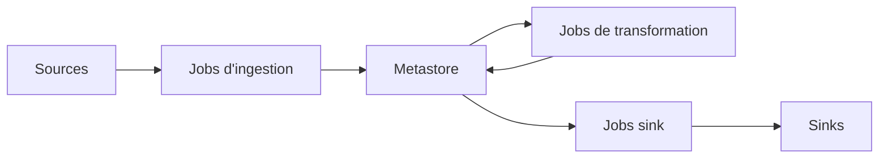

# AbsaOSS/pramen

> Configuration-driven Spark framework for defining and coordinating data and ML pipelines.

## The problem
Companies have heterogeneous sources outside the data lake. Reloads, late data and dependency ordering have to be handled by hand.

## What it actually does
A pipeline declares sources, a metastore (Parquet or Delta on HDFS or S3) and sinks. Three job types: ingestion, transformation, sink. Transformations are written in Scala or Python. Pramen keeps job state, resolves dependencies, reruns what failed and sends e-mail alerts on schema changes.

## How it is wired
Simplified diagram based on the fiche, no diagram provided.



## Trying it
```bash
git clone https://github.com/AbsaOSS/pramen
cd pramen
sbt -DSPARK_VERSION="3.5.5" ++2.12.21 assembly
spark-submit --master yarn --deploy-mode client --class za.co.absa.pramen.runner.PipelineRunner pipeline-runner-0.12.10.jar --workflow ingestion_pipeline.conf --rerun 2022-01-01
```

## Cost and gotchas
Needs a Spark cluster, JDK 1.8 and SBT to build. The tracking table (bookkeeping) requires PostgreSQL, or SQLite for testing.

## What it is not
Not a real-time orchestrator: it targets daily or less frequent batches. The README is truncated and does not cover all sinks.

## Alternatives
No alternative named in the README.

## For you
Worth watching: useful if you already have Spark and T+1 batches to orchestrate, otherwise too heavy to install for little gain.
