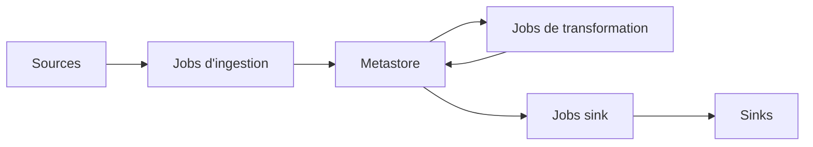

# AbsaOSS/pramen

> Framework Spark pilotable par configuration pour définir et coordonner des pipelines de données et de ML.

## Le problème
Les entreprises ont des sources hétérogènes hors du data lake. Il faut gérer à la main les rechargements, les données tardives et l'ordre des dépendances.

## Ce que ça fait vraiment
Un pipeline déclare des sources, un metastore (Parquet ou Delta sur HDFS ou S3) et des sinks. Trois types de jobs : ingestion, transformation, sink. Les transformations s'écrivent en Scala ou Python. Pramen garde l'état des jobs, résout les dépendances, relance ce qui a échoué et alerte par e-mail sur les changements de schéma.

## Comment c'est branché
Schéma simplifié d'après la fiche, sans diagramme fourni.



## Essayer
```bash
git clone https://github.com/AbsaOSS/pramen
cd pramen
sbt -DSPARK_VERSION="3.5.5" ++2.12.21 assembly
spark-submit --master yarn --deploy-mode client --class za.co.absa.pramen.runner.PipelineRunner pipeline-runner-0.12.10.jar --workflow ingestion_pipeline.conf --rerun 2022-01-01
```

## Coût et pièges
Demande un cluster Spark, JDK 1.8 et SBT pour compiler. La table de suivi (bookkeeping) nécessite PostgreSQL, ou SQLite pour tester.

## Ce que ce n'est pas
Pas un orchestrateur temps réel : il vise les lots quotidiens ou moins fréquents. Le README est tronqué et ne couvre pas tous les sinks.

## Alternatives
Aucune alternative nommée dans le README.

## Pour toi
À surveiller : utile si tu as déjà Spark et des lots T+1 à orchestrer, sinon c'est trop lourd à installer pour peu de gain.

