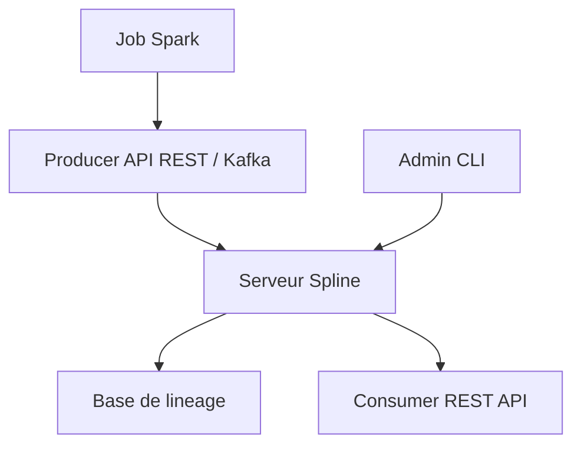

# AbsaOSS/spline

> Open source data lineage tracking server for Apache Spark and other engines.

## The problem
Knowing where a table produced by a Spark job comes from and which transformations created it is hard without automatic tracking.

## What it actually does
Spline server with a producer API (REST and Kafka) and a REST consumer API, plus an admin CLI. The README details almost nothing else: operation is deferred to the online documentation.

## How it is wired
Simplified diagram based on the sheet, no diagram provided.



## Trying it
```bash
mvn install
mvn install -Ddocker -Ddockerfile.repositoryUrl=my
```

## Cost and gotchas
Java 21 and Maven 3.9 to build. The storage database is not named in the README: not documented. Docker for the images.

## What it is not
Not a tool you launch with one command from this README: getting started goes through the documentation site.

## Alternatives
None cited in the README.

## For you
Watch: relevant if you do Spark in an enterprise and need lineage, but the README alone does not let you assess the effort.
