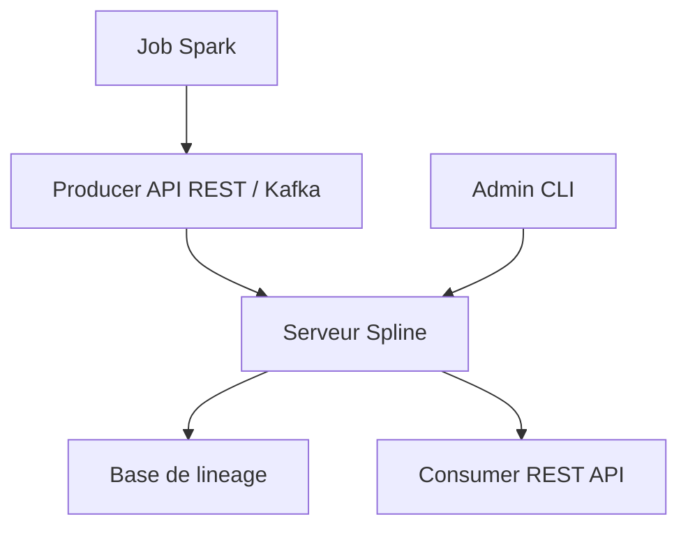

# AbsaOSS/spline

> Serveur open source de traçabilité des données (lineage) pour Apache Spark et d'autres moteurs.

## Le problème
Savoir d'où vient une table produite par un job Spark et quelles transformations l'ont créée est difficile sans suivi automatique.

## Ce que ça fait vraiment
Serveur Spline avec une API de production (REST et Kafka) et une API de consultation REST, plus un CLI d'administration. Le README ne détaille presque rien d'autre : le fonctionnement est renvoyé à la documentation en ligne.

## Comment c'est branché
Schéma simplifié d'après la fiche, sans diagramme fourni.



## Essayer
```bash
mvn install
mvn install -Ddocker -Ddockerfile.repositoryUrl=my
```

## Coût et pièges
Java 21 et Maven 3.9 pour compiler. La base de stockage n'est pas nommée dans le README : non documenté. Docker pour les images.

## Ce que ce n'est pas
Pas un outil qui se lance en une commande depuis ce README : la prise en main passe par le site de documentation.

## Alternatives
Aucune citée dans le README.

## Pour toi
Surveiller : pertinent si tu fais du Spark en entreprise et as besoin de lineage, mais le README seul ne permet pas d'évaluer l'effort.

