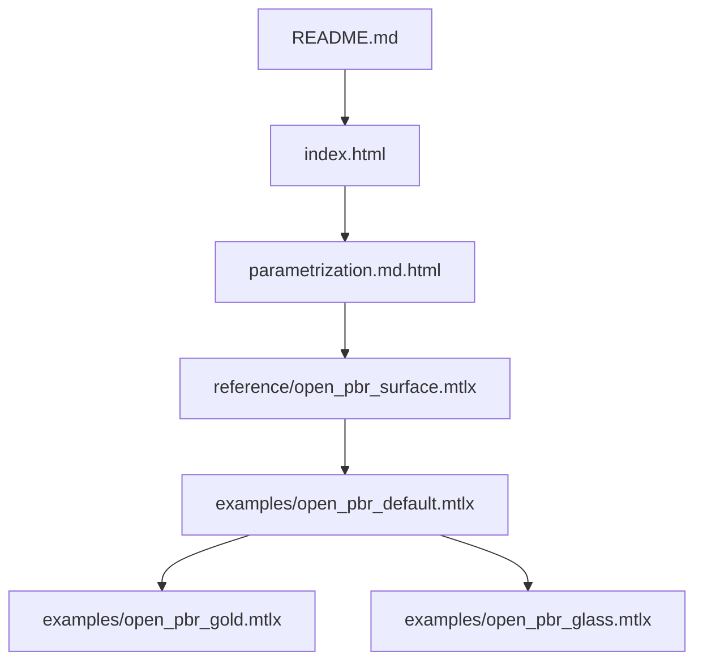

# AcademySoftwareFoundation/OpenPBR

> Open specification of a PBR surface model for visual effects and animation materials.

## The problem
Each renderer has its own material model, which prevents exchanging assets.

## What it actually does
Publishes the white paper and the parameter reference as HTML pages, a reference implementation in MaterialX (reference/open_pbr_surface.mtlx) and example materials (default, gold, glass). WebGL viewers and an Adobe implementation are listed as resources.

## How it is wired

## Trying it
No documented command: the specification is read online.

## Cost and gotchas
Free, nothing to install to read it. To use it you need a MaterialX-compatible renderer.

## What it is not
Not a renderer or a library: a specification and its reference implementation.

## Alternatives
No alternative cited in the README.

## For you
Ignore: 3D materials standard, useful only if you do rendering or 3D synthetic data generation.
