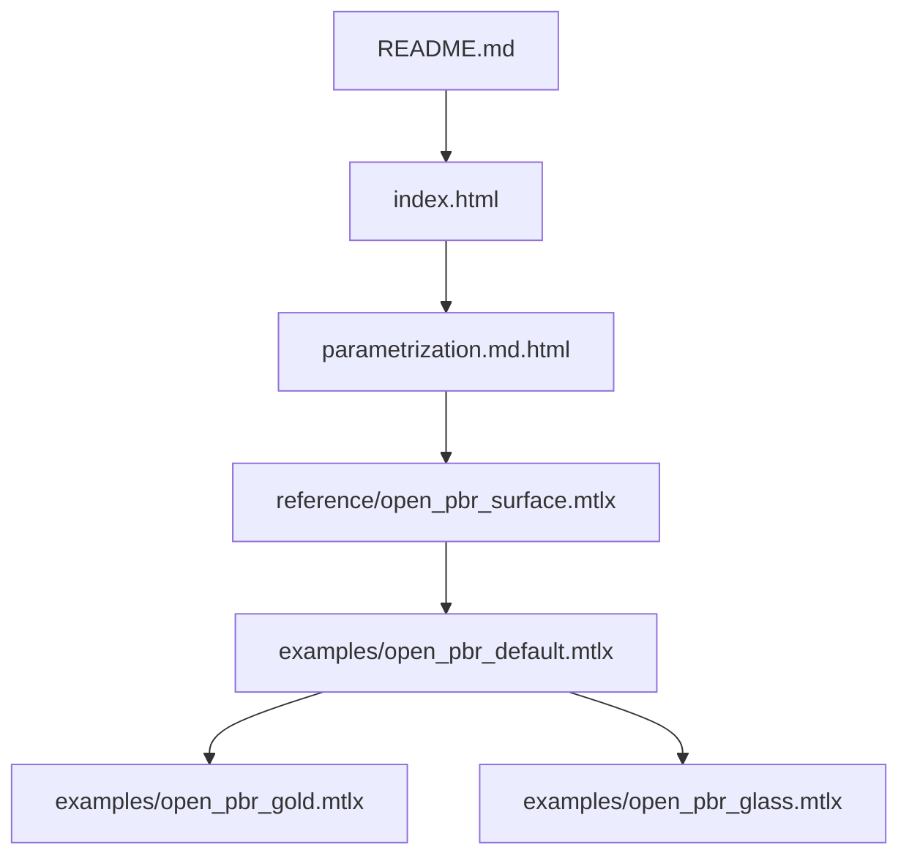

# AcademySoftwareFoundation/OpenPBR

> Spécification ouverte d'un modèle de surface PBR pour matériaux d'effets visuels et d'animation.

## Le problème
Chaque moteur de rendu a son propre modèle de matériau, ce qui empêche d'échanger des assets.

## Ce que ça fait vraiment
Publie le livre blanc et la référence des paramètres en pages HTML, une implémentation de référence en MaterialX (reference/open_pbr_surface.mtlx) et des matériaux d'exemple (défaut, or, verre). Des visionneuses WebGL et une implémentation Adobe sont listées en ressources.

## Comment c'est branché

## Essayer
Aucune commande documentée : la spécification se lit en ligne.

## Coût et pièges
Gratuit, rien à installer pour lire. Pour l'utiliser il faut un moteur de rendu compatible MaterialX.

## Ce que ce n'est pas
Pas un moteur de rendu ni une bibliothèque : une spécification et son implémentation de référence.

## Alternatives
Aucune alternative citée dans le README.

## Pour toi
Ignorer : standard de matériaux 3D, utile seulement si tu fais du rendu ou de la génération de données synthétiques 3D.

