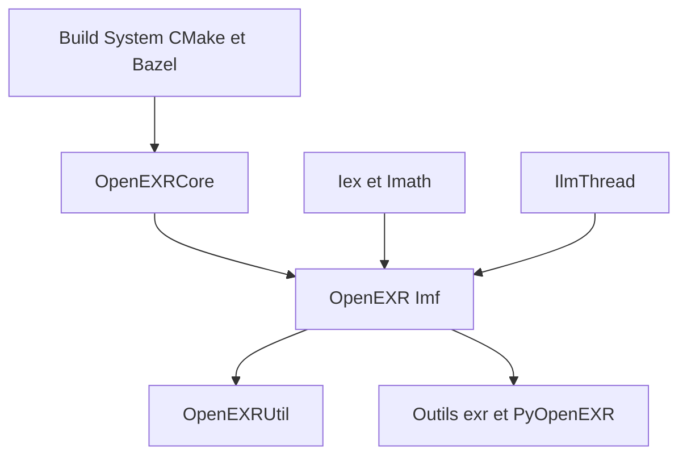

# AcademySoftwareFoundation/openexr

> The reference implementation of the high dynamic range EXR image format, a film industry standard.

## The problem
Storing high dynamic range images, with multiple channels and metadata, without loss of precision or a proprietary format.

## What it actually does
C (OpenEXRCore) and C++ (Imf, Iex, IlmThread, OpenEXRUtil) library to read and write multi-part EXR files, with compression, plus `exr*` command-line tools and Python bindings. It targets only 2D data, not volumetric.

## How it is wired
Diagram taken from the code, simplified.



## Trying it
```bash
cmake -S . -B _build -DCMAKE_PREFIX_PATH=<chemin>
cmake --build _build
```

## Cost and gotchas
Free, BSD-3-Clause license, an Academy Software Foundation project. You must build with CMake (or Bazel).

## What it is not
Not a general-purpose image tool: EXR is not suited to volumetric data or 3D scenes. Imath is not a full linear algebra library.

## Alternatives
No alternative named in the README.

## For you
Keep an eye on it: worth remembering if you handle HDR image sets (synthetic rendering, computer vision), otherwise irrelevant.
