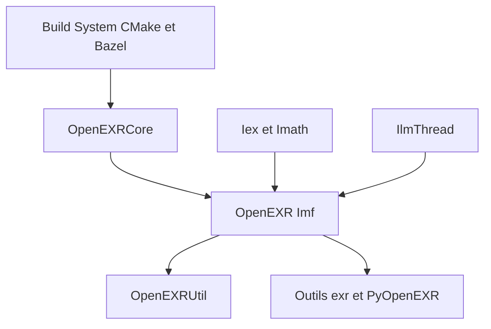

# AcademySoftwareFoundation/openexr

> L'implémentation de référence du format d'image EXR haute dynamique, standard du cinéma.

## Le problème
Stocker des images à grande plage dynamique, avec canaux et métadonnées multiples, sans perte de précision ni format propriétaire.

## Ce que ça fait vraiment
Bibliothèque C (OpenEXRCore) et C++ (Imf, Iex, IlmThread, OpenEXRUtil) pour lire et écrire des fichiers EXR multi-parties, avec compression, plus des outils en ligne de commande `exr*` et des liaisons Python. Elle ne vise que des données 2D, pas le volumétrique.

## Comment c'est branché
Diagramme tiré du code, simplifié.



## Essayer
```bash
cmake -S . -B _build -DCMAKE_PREFIX_PATH=<chemin>
cmake --build _build
```

## Coût et pièges
Gratuit, licence BSD-3-Clause, projet de l'Academy Software Foundation. Il faut compiler avec CMake (ou Bazel).

## Ce que ce n'est pas
Pas un outil généraliste d'images : EXR ne convient pas au volumétrique ni aux scènes 3D. Imath n'est pas une bibliothèque d'algèbre linéaire complète.

## Alternatives
Aucune alternative nommée dans le README.

## Pour toi
À surveiller : à retenir si tu manipules des jeux d'images HDR (rendu synthétique, vision par ordinateur), sinon sans objet.

