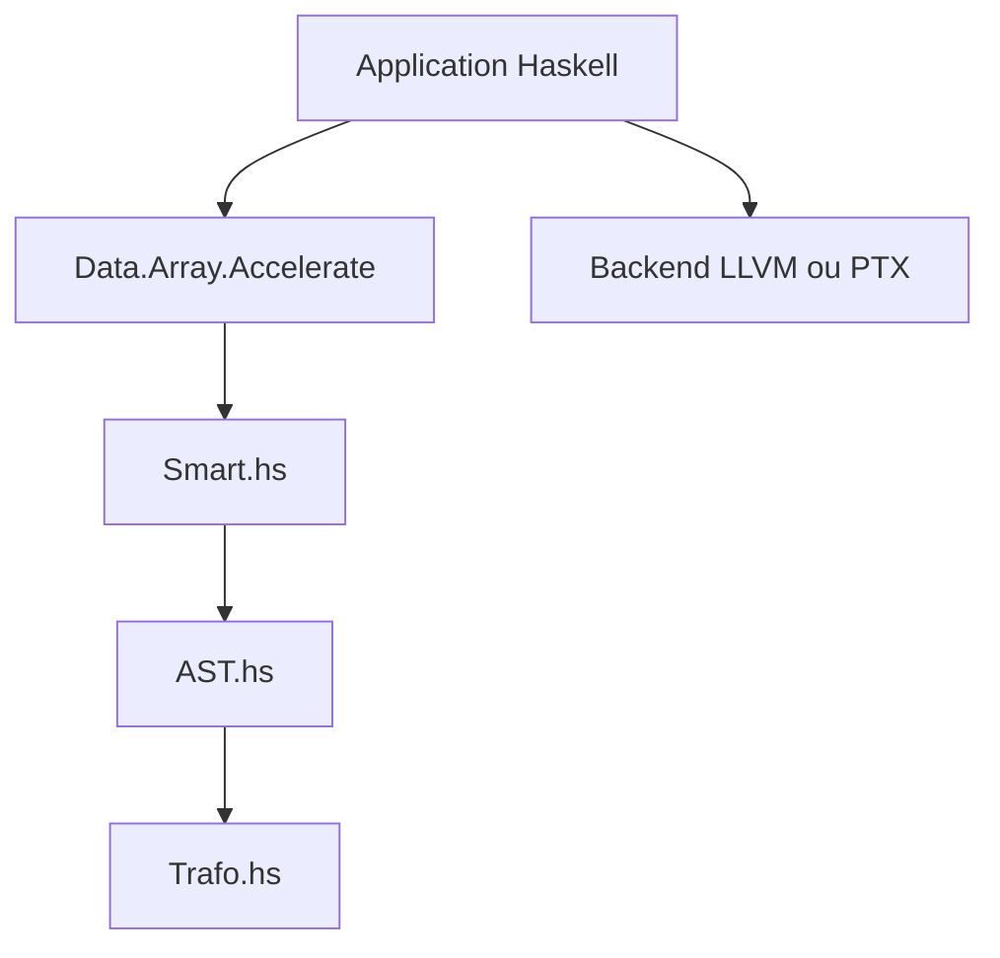

# AccelerateHS/accelerate

> Embedded Haskell language for multidimensional array computations, compiled for CPU or GPU.

## The problem
Writing high-performance parallel array computation in Haskell requires low-level code.

## What it actually does
You express collective operations (maps, reductions, permutations) in the `Acc` type, then a separate backend compiles and runs them: multicore LLVM or CUDA via PTX. According to the code, the "smart" terms are lowered to an AST, then optimized (fusion, sharing). A reference interpreter exists in the repository, but not the backends. The API is announced as preliminary.

## How it is wired


## Trying it
```bash
git clone https://github.com/AccelerateHS/accelerate.git
cabal get accelerate-examples
```

## Cost and gotchas
Free. An NVIDIA GPU with compute capability 3.0 or higher for the PTX backend; the Haskell toolchain is installed with GHCup. The backends are separate packages. License not identified by GitHub.

## What it is not
Not a machine-learning framework: an array library in Haskell.

## Alternatives
No alternative named in the README (it cites the repa repository).

## For you
Ignore: academically interesting but in Haskell, far from your usual data and AI tools.
