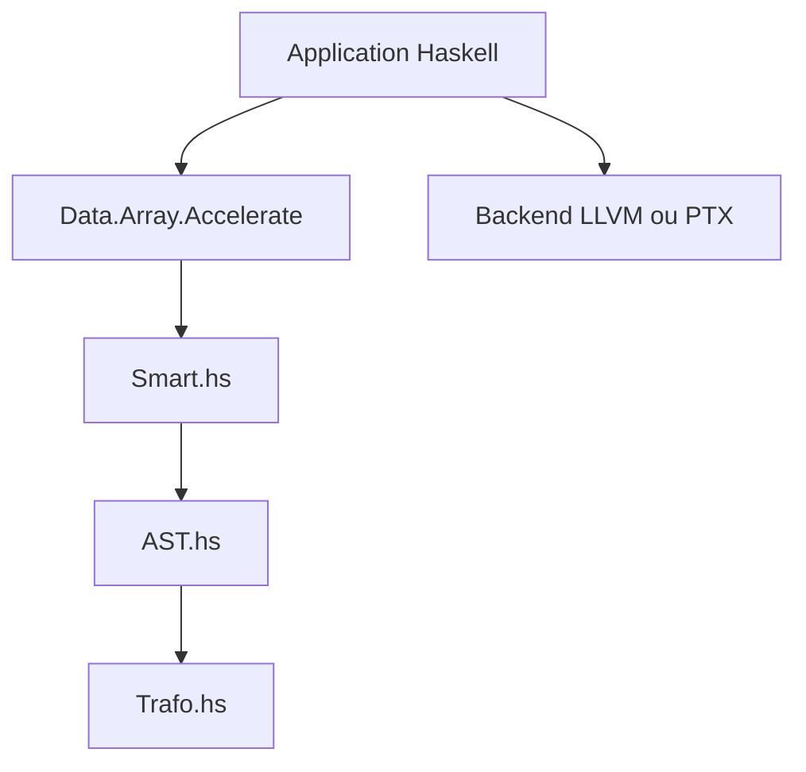

# AccelerateHS/accelerate

> Langage embarqué en Haskell pour calculs sur tableaux multidimensionnels, compilés pour CPU ou GPU.

## Le problème
Écrire du calcul parallèle sur tableaux en Haskell à haute performance exige du code bas niveau.

## Ce que ça fait vraiment
On exprime des opérations collectives (maps, réductions, permutations) dans le type `Acc`, puis un backend séparé les compile et les exécute : LLVM multicœur ou CUDA via PTX. D'après le code, les termes « smart » sont abaissés en AST, puis optimisés (fusion, partage). Un interpréteur de référence existe dans le dépôt, mais pas les backends. L'API est annoncée préliminaire.

## Comment c'est branché


## Essayer
```bash
git clone https://github.com/AccelerateHS/accelerate.git
cabal get accelerate-examples
```

## Coût et pièges
Gratuit. Un GPU NVIDIA de capacité 3.0 ou plus pour le backend PTX ; la chaîne Haskell s'installe avec GHCup. Les backends sont des paquets à part. Licence non identifiée par GitHub.

## Ce que ce n'est pas
Pas un framework d'apprentissage automatique : une bibliothèque de tableaux en Haskell.

## Alternatives
Aucune alternative nommée dans le README (il cite le dépôt repa).

## Pour toi
À ignorer : intéressant académiquement mais en Haskell, loin de tes outils data et IA habituels.

