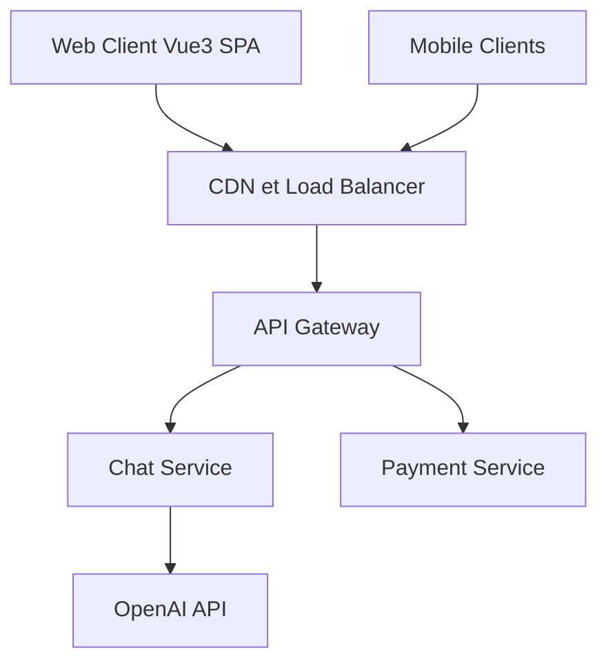

# AceDataCloud/Nexior

> Self-hostable web and mobile application unifying AI chat, image, music and video, through a single AceData key.

## The problem
Using each AI model requires an account and an interface per provider.

## What it actually does
A Vue 3.5 front end (web, iOS and Android via Capacitor) that calls the hosted AceData platform: ChatGPT, Claude, Gemini, Midjourney, Suno, Veo, Kling and others. It includes accounts, payments and a referral system with commissions. Judging from the code, there is no backend in this repository: everything goes through the hosted APIs.

## How it is wired


## Trying it
```bash
git clone https://github.com/AceDataCloud/Nexior.git
cd Nexior
cp .env.example .env
docker compose up -d
npm install
npm run dev
```

## Cost and gotchas
An AceData key is mandatory, usage is billed: check the pricing before generating. Hosting is at your expense.

## What it is not
Not a local tool: you depend on the AceData service. The diagram from the code describes microservices that are not in this repository.

## Alternatives
No alternative named in the README.

## For you
Ignore: it is a consumer interface tied to a third-party service, of little use for data or MLOps work.
