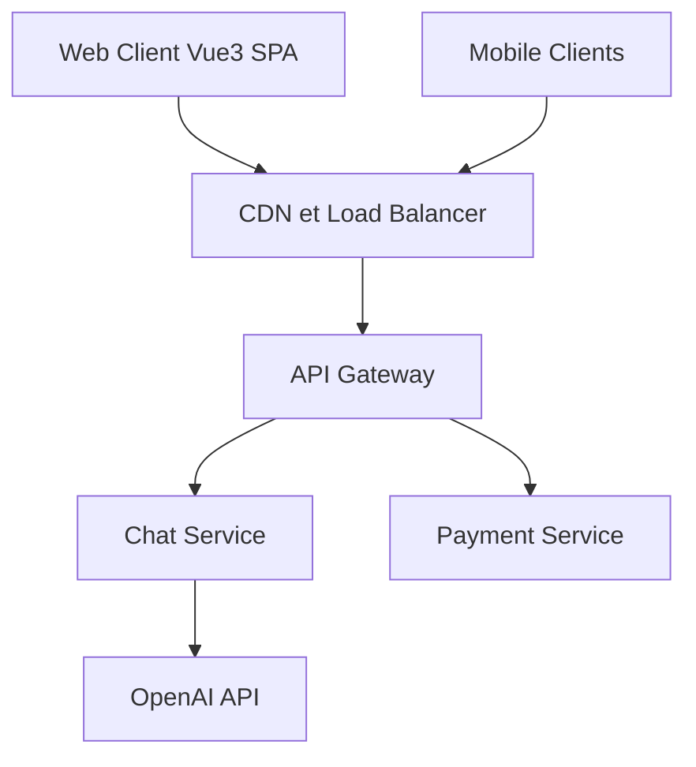

# AceDataCloud/Nexior

> Application web et mobile unifiant chat, image, musique et vidéo IA, à auto-héberger, via une seule clé AceData.

## Le problème
Utiliser chaque modèle IA exige un compte et une interface par fournisseur.

## Ce que ça fait vraiment
Un front Vue 3.5 (web, iOS et Android via Capacitor) qui appelle la plateforme hébergée AceData : ChatGPT, Claude, Gemini, Midjourney, Suno, Veo, Kling et d'autres. Il inclut comptes, paiements et un système de parrainage avec commissions. D'après le code, il n'y a pas de backend dans ce dépôt : tout passe par les API hébergées.

## Comment c'est branché


## Essayer
```bash
git clone https://github.com/AceDataCloud/Nexior.git
cd Nexior
cp .env.example .env
docker compose up -d
npm install
npm run dev
```

## Coût et pièges
Clé AceData obligatoire, usage facturé : consulte la tarification avant de générer. L'hébergement est à ta charge.

## Ce que ce n'est pas
Pas un outil local : tu dépends du service AceData. Le diagramme du code décrit des microservices qui ne sont pas dans ce dépôt.

## Alternatives
Aucune alternative nommée dans le README.

## Pour toi
À ignorer : c'est une interface grand public liée à un service tiers, peu utile pour du travail data ou MLOps.

