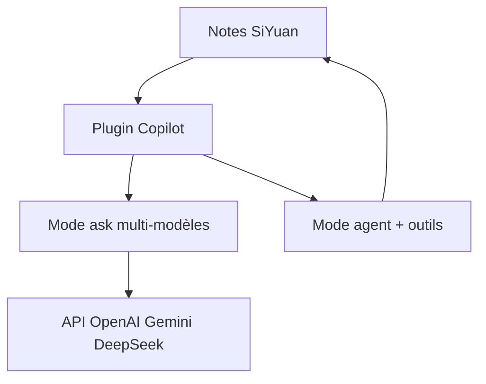

# Achuan-2/siyuan-plugin-copilot

> AI assistant plugin for the SiYuan note-taking app, with answers from several models and an agent mode.

## The problem
Asking an AI about your notes means copy-pasting between several tools and models.

## What it actually does
Inside SiYuan, you drag blocks, pages or images to the AI. Ask mode queries several models at once so you can pick the best answer. Agent mode can search, edit and create notes. It also offers presets, quick translation, image generation and custom skills. It works with OpenAI, Gemini, DeepSeek, Volcengine and any OpenAI-compatible API.

## How it is wired
Simplified diagram based on the sheet, no diagram provided.



## Trying it
```bash
pnpm install
pnpm run dev
```

## Cost and gotchas
The plugin does not provide the AI: you need your own API key, with the bill that comes with it. The README is in Chinese. Agent mode can modify your notes.

## What it is not
Not a standalone product: it only works inside SiYuan. The README opens with a sponsor, an image-generation service.

## Alternatives
No alternative named in the README; it cites Cherry Studio as a source of inspiration.

## For you
Worth watching: only if you already take notes in SiYuan; otherwise nothing to gain from it for a data, AI or MLOps profile.
